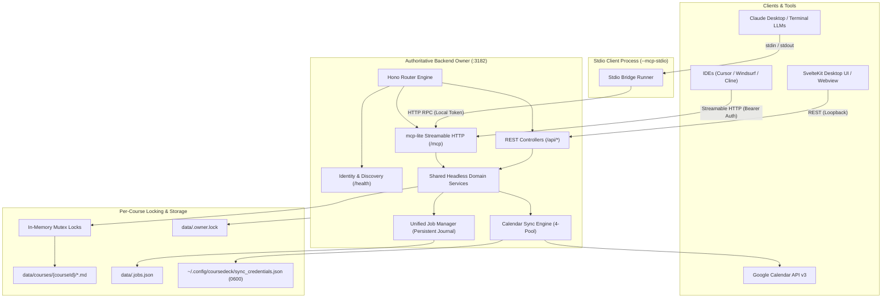
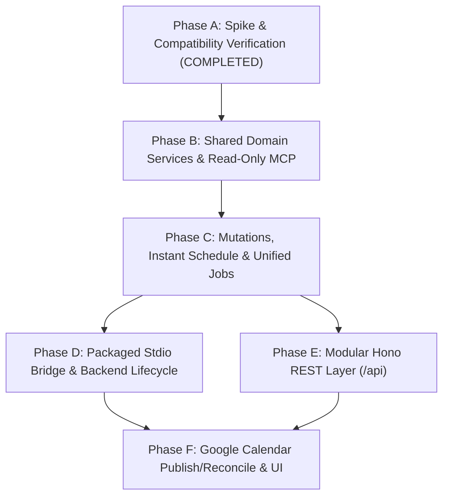

# Technical Architecture & Implementation Plan: CourseDeck API, MCP Server, and Calendar Sync

**Project:** `ilc-study-tool` (CourseDeck)  
**Document Revision:** Revision 3 (Post-Audit Technical Guidance Integration)  
**Reference Document:** `docs/api-mcp-revision.md`  
**Frameworks:** Hono (`hono` v4) + Fiberplane `mcp-lite` (`mcp-lite` v0.10) + Zod (`zod` v4)  
**Status:** Implementation Underway (Phase A Spike Validated)  

---

## 1. System Topology & Process Ownership

CourseDeck employs an **Authoritative Backend Owner** model. A single backend process owns a configured data directory, its mutation locks, its job registry, and external synchronization. 

Both the SvelteKit REST controllers and the MCP Streamable HTTP transport execute inside this owner process. The desktop CLI / Claude Desktop `stdio` launcher acts as an authenticated protocol bridge/client to this authoritative owner, avoiding split-brain concurrency or duplicate worker queues.



---

## 2. Process Lifecycle, Discovery & Ownership Contract

### 2.1 Backend Discovery & `/health` Identity Contract
A bound port `3182` does not prove CourseDeck owns it. The server exposes a lightweight, unauthenticated health and identity endpoint at `GET /health`:
```json
{
  "status": "ok",
  "app": "coursedeck",
  "version": "0.1.0",
  "protocolVersion": "2025-03-26",
  "datasetId": "4a7b9c1d",
  "uptime": 124.5
}
```
* **Dataset Identity:** `datasetId` is an opaque 8-character hex hash of the resolved canonical `DATA_DIR` path. It prevents a client intended for dataset A from inadvertently mutating dataset B.
* **Conflicting Ports:** If port `3182` returns an error or an unrecognized application identity, startup aborts with an explicit diagnostic (`PORT_IN_USE_BY_FOREIGN_PROCESS`), rather than silently failing or scanning arbitrary ports.

### 2.2 Atomic Owner Lock (`data/.owner.lock`)
To guarantee that two backend processes (e.g., SvelteKit dev server and a standalone sidecar) never write concurrently to the same course directory:
* The backend establishes an atomic lock on `data/.owner.lock` using file descriptor locking (`fcntl` / `flock` via Bun file system APIs).
* The lockfile records: `{ pid: number, startedAt: string, datasetId: string, port: number }`.
* If a secondary launcher detects an active lock with a matching, healthy `datasetId`, it attaches as a client. If the lock is held by a dead process (detected via `process.kill(pid, 0)`), the stale lock is safely replaced.

### 2.3 Headless Operation & GUI Lifecycle
* When Tauri launches, it spawns or connects to the authoritative backend.
* If the user closes the GUI window, the backend checks `JobManager.hasActiveJobs()`. If long-running AI generation or calendar sync jobs are in flight, the backend remains running in headless mode with an idle timeout (15 minutes of inactivity after all jobs finish).
* An explicit shutdown signal (`SIGTERM` / `SIGINT`) halts admission, transitions running jobs to `interrupted`, flushes queue journals to disk, and removes `.owner.lock`.

---

## 3. Security, Trust Boundary & Transport Guardrails

### 3.1 Network & Header Enforcement
The backend strictly binds to `127.0.0.1` (loopback only) and enforces:
* **Allowed Host:** Validates `req.headers.get('host')`. Must match `127.0.0.1:${PORT}` or `localhost:${PORT}`. Foreign Host headers return `400 Bad Request`.
* **Origin Policy:** Per the MCP transport specification, any request presenting an invalid or untrusted `Origin` header is rejected immediately with `403 Forbidden`. Allowed origins: `tauri://localhost`, `https://tauri.localhost`, `http://localhost:${PORT}`, `http://127.0.0.1:${PORT}`.
* **Native Clients & Local Bearer Token:** Native clients (Claude Desktop, Cursor) lacking browser `Origin` headers must supply a local bearer token via `Authorization: Bearer <token>` or `Mcp-Secret-Key`. The token is randomly generated per dataset session and stored in `data/.mcp-token` with `0600` permissions.
* **Payload Limits:**
  * General REST / Tool Calls: **2 MB** maximum request body limit.
  * Backup Import (`/api/backup/import`): **1 GB** streaming multipart limit (explicitly isolated to the backup controller).

### 3.2 Secure Credential Storage
* OAuth credentials (`access_token`, `refresh_token`, `client_id`) are stored in `~/.config/coursedeck/sync_credentials.json` (or `$ILC_SETTINGS_PATH/sync_credentials.json`).
* **Never Stored in `data/`:** Kept strictly outside the course data directory to ensure that course zip archives exported by `backup.ts` never leak OAuth tokens.
* All error handlers and logs redact `Authorization`, `access_token`, `refresh_token`, and API keys.

---

## 4. Unified Job Model & Long-Running LLM Semantics

### 4.1 Shared Job Architecture (`JobManager`)
Replaces the disparate `queue.ts` (`GenerationQueue`) and `api.ts` (`activeCourseDocJobs`) with a unified, persistent job store in `app/src/lib/server/services/job.service.ts`:

```typescript
export type JobKind = 'generate_lesson_doc' | 'generate_course_doc' | 'prompt_course';
export type JobState =
  | 'queued'
  | 'running'
  | 'succeeded'
  | 'failed'
  | 'cancel_requested'
  | 'cancelled'
  | 'interrupted';

export type JobResult =
  | { type: 'document'; courseId: string; lessonId?: string; tab: string; filePath: string }
  | { type: 'prompt_answer'; courseId: string; answer: string; usage?: { promptTokens: number; completionTokens: number } };

export interface JobRecord {
  id: string;                         // UUID
  dedupKey: string;                   // e.g. "mcr3u:01.01:summary" or prompt-hash
  kind: JobKind;
  courseId: string;
  lessonId?: string;
  tab?: string;
  state: JobState;
  createdAt: string;
  startedAt?: string;
  finishedAt?: string;
  progress?: { completed: number; total?: number; message?: string };
  result?: JobResult;
  error?: { code: string; message: string; retryable: boolean };
}
```

* **Persistence:** Job state transitions are journaled atomically to `data/.jobs.json`. Unfinished jobs (`running`) on startup are safely marked `interrupted`.
* **Bounded Wait Without Duplicate Enqueueing:**
  1. Validates request and checks if artifact already exists.
  2. If missing, checks `JobManager.findActive(dedupKey)`. If none exists, creates one job.
  3. Waits up to a bounded deadline (e.g., 20 seconds).
  4. If the job finishes within the deadline, returns the result directly.
  5. If still running when the deadline elapses, returns `{ status: "generating", jobId, checkStatusWith: "get_task_status" }`. The background worker continues executing; it is **not** aborted or duplicated.

### 4.2 Companion Polling Tool: `get_task_status`
```typescript
mcp.tool("get_task_status", {
  description: "Check progress or retrieve completed results for an asynchronous AI generation job.",
  inputSchema: z.object({
    jobId: z.string().describe("Job ID returned by get_lesson_doc or prompt_course")
  }),
  handler: async (args) => {
    const job = JobManager.getJob(args.jobId);
    if (!job) return { isError: true, content: [{ type: "text", text: `Job '${args.jobId}' not found.` }] };
    return { content: [{ type: "text", text: JSON.stringify(job, null, 2) }] };
  }
});
```

---

## 5. Model Context Protocol Tools Specification (`mcp-lite`)

Tools are registered using `mcp-lite` and Zod v4 schemas (`z.toJSONSchema`).

### 5.1 Artifact Scope & Vocabulary Matrix
Aligns strictly with `app/src/lib/tabs.ts` (`BUILT_IN_TABS`, `COURSE_TABS`, `RESERVED_TABS`):

| Tab Argument | Lesson Scope (`lessonId` provided) | Course Scope (`lessonId` omitted) |
| :--- | :--- | :--- |
| `lesson` (alias: `full`) | Stored original lesson source (`{id}.lesson.md`) | Rejects (Lesson source cannot exist at course scope) |
| `summary` | Stored/generated summary (`{id}.summary.md`) | Stored/generated course summary (`course.summary.md`) |
| `cheatsheet` | Stored/generated cheatsheet (`{id}.cheatsheet.md`) | Stored/generated course cheatsheet (`course.cheatsheet.md`) |
| `test` (alias: `practice-sheet`)| Stored/generated practice test (`{id}.test.md`) | Stored/generated course exam (`course.test.md`) |
| `schedule` | Rejects (Schedules only exist at course scope) | Stored deterministic schedule (`course.schedule.md`) |
| `notes` | Rejects (Notes is an aggregate view) | Aggregated course notes across all lessons |

---

### 5.2 Tool Catalog

#### 1. `list_courses`
* **Description:** Lists courses with metadata, lesson counts, and course-level document availability flags.
* **Input Schema:**
  ```typescript
  z.object({
    includeArchived: z.boolean().default(false),
    search: z.string().optional()
  })
  ```

#### 2. `get_course` (Net-New Discovery Tool)
* **Description:** Retrieves complete course manifest, unit breakdown, and lesson inventory.
* **Input Schema:**
  ```typescript
  z.object({
    id: z.string().describe("Course slug, e.g. 'mcr3u'")
  })
  ```

#### 3. `list_lessons` (Net-New Discovery Tool)
* **Description:** Lists lessons for a course with unit numbers, titles, types, and existing tab files.
* **Input Schema:**
  ```typescript
  z.object({
    courseId: z.string().describe("Course ID, e.g. 'mcr3u'"),
    unitNumber: z.number().int().optional().describe("Filter by unit")
  })
  ```

#### 4. `create_course` (Net-New Service Method)
* **Semantics:** Validates `assertCourseId(id).toLowerCase()`. Throws 409 Conflict if directory exists. Creates directory structure and seeds `meta.json` with `units: []`.
* **Input Schema:**
  ```typescript
  z.object({
    id: z.string().regex(/^[a-zA-Z0-9][a-zA-Z0-9._-]{0,63}$/),
    title: z.string().min(1).max(200),
    grade: z.string().default("11"),
    level: z.string().default("University"),
    description: z.string().default("")
  })
  ```

#### 5. `delete_course` (Net-New Service Method + Durable Cleanup)
* **Semantics:**
  * `permanent: false`: Archives course (sets `archived: true` in `meta.json`).
  * `permanent: true`: Recursively deletes directory using `safeJoin` validation.
  * **Calendar Cleanup:** Registers durable cleanup intent in `data/.cleanup_queue.json` to purge remote calendar events matching `extendedProperties.private.courseId === id`.
* **Input Schema:**
  ```typescript
  z.object({
    id: z.string(),
    permanent: z.boolean().default(false)
  })
  ```

#### 6. `inject_lessons` (Atomic Batch Injection)
* **Semantics:** Validates full batch before writing. Distinguishes assignments (`type: 'assignment'`) by generating IDs like `01.06_assign1`. Atomic file writes (`.tmp` $\to$ rename). Updates unit/lesson manifest in `meta.json`. Defaults `overwriteExisting` to `false`.
* **Input Schema:**
  ```typescript
  z.object({
    courseId: z.string(),
    lessons: z.array(z.object({
      unitNumber: z.number().int().min(1),
      unitTitle: z.string().optional(),
      lessonNumber: z.number().int().min(1),
      title: z.string().min(1),
      type: z.enum(["lesson", "assignment"]).default("lesson"),
      tab: z.enum(["lesson", "summary", "cheatsheet", "test"]).default("lesson"),
      content: z.string().min(1),
      code: z.string().optional()
    })),
    overwriteExisting: z.boolean().default(false)
  })
  ```

#### 7. `get_lesson_doc`
* **Semantics:** Retrieves document content using canonical vocabulary and aliases. If missing and `generateIfMissing: true`, delegates to `JobManager` with bounded synchronous wait, returning either content or an async job handle.
* **Input Schema:**
  ```typescript
  z.object({
    courseId: z.string(),
    lessonId: z.string().optional(),
    tab: z.enum(["lesson", "summary", "cheatsheet", "test", "schedule", "notes", "full", "practice-sheet"]).default("summary"),
    generateIfMissing: z.boolean().default(true)
  })
  ```

#### 8. `search_course` (Net-New Scored Search Service)
* **Semantics:** Scans markdown files across course lessons. Computes transparent score: Title match (+10), Markdown header (+5), Body occurrence (+1). Returns ranked results with $\pm 80$ character snippets stripped of raw markdown syntax.
* **Input Schema:**
  ```typescript
  z.object({
    query: z.string().min(1),
    courseId: z.string().optional(),
    limit: z.number().int().min(1).max(50).default(20)
  })
  ```

#### 9. `build_course_schedule` (Deterministic Instant Engine)
* **Semantics:** Aligned 1:1 with `SchedulePreferences` (`schedule.ts:17-42`). Uses `buildScheduleSkeleton()` to deterministically calculate timetable and effort weights in milliseconds without LLM dependency. Saves `course.schedule.md` and returns immediately.
* **Input Schema:**
  ```typescript
  z.object({
    courseId: z.string(),
    startDate: z.string().regex(/^\d{4}-\d{2}-\d{2}$/),
    targetEndDate: z.string().regex(/^\d{4}-\d{2}-\d{2}$/).optional(),
    studyDays: z.array(z.number().int().min(0).max(6)).default([1, 2, 3, 4, 5]),
    sessionLengthMin: z.number().int().min(15).max(360).default(60),
    sessionsPerDay: z.number().int().min(1).max(6).default(1),
    paceMode: z.enum(["steady", "target"]).default("steady"),
    includeReviews: z.boolean().default(true),
    reviewIntensity: z.enum(["light", "standard", "heavy"]).default("standard"),
    includeCatchupDays: z.boolean().default(true),
    blackoutDates: z.array(z.object({
      startDate: z.string().regex(/^\d{4}-\d{2}-\d{2}$/),
      endDate: z.string().regex(/^\d{4}-\d{2}-\d{2}$/),
      label: z.string().optional()
    })).default([]),
    dayTimes: z.record(z.string(), z.array(z.string())).optional(),
    notes: z.string().optional()
  })
  ```

#### 10. `get_course_schedule`
* **Semantics:** Returns active `course.schedule.md` markdown and parsed milestones.
* **Input Schema:**
  ```typescript
  z.object({
    courseId: z.string()
  })
  ```

#### 11. `prompt_course` (Budget-Aware Context Aggregator)
* **Semantics:** Aggregates course material under a strict hard ceiling `MAX_PROMPT_COURSE_CHARS = 120_000` (~30,000 tokens). Prioritizes curated summaries over raw lesson text. For long runs (>20s), transitions to `JobManager` async task.
* **Input Schema:**
  ```typescript
  z.object({
    courseId: z.string(),
    prompt: z.string().min(1),
    contextScope: z.enum(["summaries_only", "full_course", "specific_lessons"]).default("summaries_only"),
    lessonIds: z.array(z.string()).optional()
  })
  ```

---

## 6. Stdio Transport Protocol Bridge

For desktop LLM clients like Claude Desktop that spawn local child processes, `server/mcp/stdio.ts` provides a dedicated stdio bridge:
1. **Dedicated Entrypoint:** Parsed before any HTTP listeners or background queues start.
2. **Stdout Framing:** Standard output (`stdout`) is reserved strictly for newline-delimited JSON-RPC messages. All startup logs and diagnostics route to `stderr`.
3. **Loopback Bridge:** Reads incoming lines from `process.stdin`, forwards them via HTTP `POST /mcp` to the Authoritative Backend with the local session token, and writes the JSON-RPC response to `process.stdout`.
4. **Packaged Invocation:** Uses absolute executable path and arguments:
   ```json
   {
     "mcpServers": {
       "coursedeck": {
         "command": "/Applications/CourseDeck.app/Contents/Resources/server",
         "args": ["--mcp-stdio"],
         "env": {
           "DATA_DIR": "/Users/user/Documents/Education/ilc"
         }
       }
     }
   }
   ```

---

## 7. Google Calendar Reconciliation Engine

### 7.1 Identity, Discovery & Extended Properties
To avoid lost sync state across restores or device migrations, every remote event is stamped with private extended properties:
```json
{
  "extendedProperties": {
    "private": {
      "appId": "coursedeck",
      "datasetId": "4a7b9c1d",
      "courseId": "mcr3u",
      "lessonId": "01.01",
      "sessionKey": "2026-11-02:01.01:study",
      "contentHash": "8f7e6d5c",
      "schemaVersion": "1"
    }
  }
}
```
* **Deterministic Event ID:** A lowercase hexadecimal hash conforming to Google Calendar ID constraints (`[0-9a-v]{5,1024}`):
  $$\text{eventId} = \text{sha256}(\text{datasetId} + \text{":"} + \text{courseId} + \text{":"} + \text{sessionKey})[0..31]$$
* **Remote Discovery:** Events are discovered by querying Google Calendar API with:
  `events.list({ calendarId, privateExtendedProperty: "appId=coursedeck" })`.

### 7.2 Reconciliation Algorithm & 4-Concurrency Pool
1. **Projection:** Projects planned sessions into desired events using `SchedulePreferences.dayTimes` and local IANA timezone (`Intl.DateTimeFormat().resolvedOptions().timeZone`), calculating real UTC offsets per date (DST aware).
2. **Discovery:** Lists all existing remote events tagged with `appId=coursedeck` for this course.
3. **Diffing:**
   - **Skip:** Events with matching `eventId` and identical `contentHash`.
   - **Upsert (Update-on-404-Insert):** Tries `events.update`; if it returns `404 Not Found`, executes `events.insert`.
   - **Delete (Clean Orphans):** Remote events tagged with this course that are no longer present in the updated schedule are deleted.
4. **Concurrency:** Operations execute through a **4-concurrency Promise pool with HTTP keep-alive**, providing fast completion without multipart batching complexity.
5. **Token Expiry Notice:** Google Cloud testing mode refresh tokens expire after 7 days; the UI displays a clear re-authentication banner upon `invalid_grant`.

### 7.3 ARC Sync Integration
The `ScheduleSyncProvider` interface abstracts sync targets:
- `GoogleCalendarProvider` (Fully implemented in Phase F).
- `ArcSyncProvider` (Interface declared; implementation explicitly deferred until the ARC API contract is published).

---

## 8. Gated Implementation Sequence



### Phase A: Spike & Compatibility Gate (PASSED)
- [x] Pin `hono@4.13.13`, `mcp-lite@0.10.0`, `zod@4.6.7`.
- [x] Prove `initialize`, `tools/list`, and `tools/call` over Streamable HTTP.
- [x] Verify Bun standalone compilation (`bun run server:compile`).
- [x] Fix baseline type check in `queue.test.ts`.

### Phase B: Shared Domain Services & Read-Only MCP
- [ ] Implement `app/src/lib/server/services/course.service.ts` (`listCourses`, `getCourse`, `listLessons`).
- [ ] Implement `app/src/lib/server/services/search.service.ts` (Scored tokenized search).
- [ ] Implement `app/src/lib/server/services/schedule.service.ts` (Read schedule).
- [ ] Mount authenticated `/mcp` on Hono router with read-only tools.
- [ ] **Acceptance Gate:** MCP client reads course catalog, searches keywords, and fetches lesson documents with zero queue duplication.

### Phase C: Mutations, Schedule Skeleton & Unified Jobs
- [ ] Implement `CourseService.createCourse()` (ID validation, 409 Conflict, seed `meta.json`).
- [ ] Implement `CourseService.deleteCourse()` (archive vs permanent delete, durable cleanup intent).
- [ ] Implement `CourseService.injectLessons()` (atomic tmp-file replacement, assignment IDs).
- [ ] Implement `ScheduleService.buildAndSaveSchedule()` wrapping `buildScheduleSkeleton()`.
- [ ] Implement `JobManager` with file-backed journal (`data/.jobs.json`).
- [ ] Add `prompt_course` (with 120k budget cap) and `get_task_status`.
- [ ] **Acceptance Gate:** Simultaneous course creation rejects conflicts; deterministic schedules save instantly; long AI generation survives polling without timeout.

### Phase D: Packaged Stdio Bridge & Lifecycle
- [ ] Implement `server/mcp/stdio.ts` with clean stdout framing.
- [ ] Implement atomic lockfile `data/.owner.lock` and `/health` discovery.
- [ ] Verify packaged executable with Claude Desktop.
- [ ] **Acceptance Gate:** Claude Desktop connects and runs tools against packaged binary with app open or closed.

### Phase E: Modular Hono REST Layer
- [ ] Split `api.ts` into modular controllers in `app/src/lib/server/api/controllers/`.
- [ ] Preserve single percent-decoding for asset filenames with literal `%`.
- [ ] Preserve streaming pass-through for backup zip downloads.
- [ ] Preserve `{ message }` error body shape with error details.
- [ ] **Acceptance Gate:** `bun run test` and `scripts/api-contract.ts` pass with zero regressions.

### Phase F: Google Calendar Reconciliation & UI
- [ ] Implement Desktop OAuth 2.0 PKCE loopback listener.
- [ ] Implement reconciliation engine (paged discovery, update-on-404-insert, orphan deletion).
- [ ] Add `[Sync]` button beside `[Re-Schedule]` on `/schedules` and course schedule views.
- [ ] Build `ScheduleSyncModal.svelte`.
- [ ] **Acceptance Gate:** Rescheduling a course cleanly reconciles remote events without duplicates or orphaned entries.
