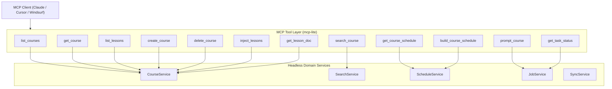

# Model Context Protocol (MCP) Architecture & Specification

## 1. Overview & Philosophy

**CourseDeck** provides native Model Context Protocol (MCP) support, enabling AI assistants, agentic IDEs, and frontier LLMs (such as Claude Desktop, Cursor, and Windsurf) to inspect curriculum structures, search lesson notes, deterministically build Ontario-aligned study schedules, and evaluate prompts directly against local course materials.

### Guiding Principles
- **Headless Domain Service Colocation**: MCP/API tool handlers and internal REST controllers (`/api/*`) call the exact same headless TypeScript domain services (`CourseService`, `SearchService`, `ScheduleService`, `JobService`, `SyncService`). Logic is never duplicated.
- **Authoritative Backend Owner**: The Bun sidecar process (`server/index.ts`) running on loopback port `3182` owns the MCP protocol layer directly via [`mcp-lite`](https://github.com/fiberplane/mcp-lite). There are no multi-hop IPC trampolines or Webview event tunnels.
- **Deterministic & Timeout-Safe**: Schedule generation executes synchronously in <10ms without LLM latency, eliminating client timeouts. Heavy operations (e.g. `prompt_course`, document generation) leverage the unified `JobService` with `get_task_status` tracking.
- **Dual Transport Support**:
  1. **Streamable HTTP**: Accessible over HTTP POST/SSE at `http://127.0.0.1:3182/mcp` for network-capable IDEs (Cursor, Windsurf).
  2. **Stdio Runner**: Accessible via `--mcp-stdio` CLI flag for process-spawned clients (Claude Desktop). Standard output is strictly reserved for newline-delimited JSON-RPC, while all diagnostics are isolated to standard error.

---

## 2. Transports & Client Configuration

### 2.1 Transport Endpoints

| Transport | Address / Command | Protocol | Authentication |
|---|---|---|---|
| **Streamable HTTP** | `http://127.0.0.1:3182/mcp` | MCP JSON-RPC 2.0 / Streamable HTTP | `Authorization: Bearer <token>` or localhost Origin |
| **Stdio Bridge** | `bun run server/index.ts --mcp-stdio` | Standard I/O (newline-delimited JSON-RPC) | Implicit (local process spawn) |
| **Health & Discovery** | `http://127.0.0.1:3182/health` | Standard HTTP GET | Open on loopback |

### 2.2 Security & Authentication
- **Loopback Enforcement**: The HTTP listener binds strictly to `127.0.0.1`.
- **Host Header Check**: Requests with foreign Host headers (e.g., DNS rebinding attacks) are rejected with `400 Bad Request`. Valid loopback hosts include `127.0.0.1`, `localhost`, and IPv6 `::1` / `[::1]`.
- **Origin Validation**: Browsers sending untrusted `Origin` headers are rejected with `403 Forbidden` unless authenticated with a valid Bearer token.
- **Persistent Secret Token**: Stored in `$DATA_DIR/.mcp-token`. Clients connecting through tunnels, proxies, or foreign origins supply this token via `Authorization: Bearer <token>` or `x-mcp-token: <token>`. Users can inspect, copy, or regenerate this token anytime directly in the desktop app under **Settings &rarr; SYNC & MCP**. Local loopback requests without headers are unrestricted.

### 2.3 Client Configurations

#### Claude Desktop
Add to your `claude_desktop_config.json` (located at `~/Library/Application Support/Claude/claude_desktop_config.json` on macOS or `%APPDATA%\Claude\claude_desktop_config.json` on Windows):

```json
{
  "mcpServers": {
    "coursedeck": {
      "command": "bun",
      "args": [
        "run",
        "/path/to/ilc-study-tool/server/index.ts",
        "--mcp-stdio"
      ]
    }
  }
}
```

*For packaged binary builds:*
```json
{
  "mcpServers": {
    "coursedeck": {
      "command": "/Applications/CourseDeck.app/Contents/MacOS/coursedeck-server",
      "args": ["--mcp-stdio"]
    }
  }
}
```

#### Cursor (`.cursor/mcp.json`)
```json
{
  "mcpServers": {
    "coursedeck": {
      "url": "http://127.0.0.1:3182/mcp"
    }
  }
}
```

#### Windsurf (`~/.codeium/windsurf/mcp_config.json`)
```json
{
  "mcpServers": {
    "coursedeck": {
      "serverUrl": "http://127.0.0.1:3182/mcp"
    }
  }
}
```

---

## 3. Tool Catalog & Specification

CourseDeck exposes **12 core tools**. Every tool is documented below with its exact Zod schema, input parameters, return structure, and failure conditions.



---

### 1. `list_courses`
List all ingested courses with metadata, lesson counts, and course-level document availability flags.

- **Annotations**: Read-only
- **Parameters**:
  - `includeArchived` *(boolean, optional, default: `false`)*: Whether to include archived/hidden courses.
  - `search` *(string, optional)*: Substring filter matching course ID, title, or code.
- **Returns**: Array of `CourseManifest` objects including `id`, `title`, `grade`, `level`, `units` summary, and `courseDocs` flags (`summary`, `cheatsheet`, `test`, `schedule`).

---

### 2. `get_course`
Retrieve the complete manifest, unit hierarchy, and metadata for a specific course.

- **Annotations**: Read-only
- **Parameters**:
  - `id` *(string, required)*: Course identifier slug (e.g. `'mcr3u'`).
- **Returns**: Full `CourseManifest` JSON object containing all units, lessons, codes, and tab presence flags.
- **Errors**:
  - Returns error if course does not exist (`Course '...' not found`).

---

### 3. `list_lessons`
List lessons for a course with unit numbers, titles, types, and existing tab files on disk.

- **Annotations**: Read-only
- **Parameters**:
  - `courseId` *(string, required)*: Course identifier (e.g. `'mcr3u'`).
  - `unitNumber` *(integer, optional)*: Filter lessons by unit index.
- **Returns**: Array of lesson descriptors including `id`, `code`, `title`, `unitNumber`, `lessonNumber`, `type`, and tab availability flags (`hasFull`, `hasSummary`, `hasNotes`, `hasTest`).

---

### 4. `create_course`
Create a new course workspace in CourseDeck. Fails with 409 Conflict if `id` already exists.

- **Annotations**: State-mutating (Local disk write)
- **Parameters**:
  - `id` *(string, required, pattern: `^[a-zA-Z0-9][a-zA-Z0-9._-]{0,63}$`)*: Course slug (e.g. `'sph4u'`).
  - `title` *(string, required, length: 1–200)*: Full human-readable course title (e.g. `'Physics 12'`).
  - `grade` *(string, optional, default: `'11'`)*: Grade level (`'11'`, `'12'`).
  - `level` *(string, optional, default: `'University'`)*: Academic level (`'University'`, `'College'`, `'Open'`).
  - `description` *(string, optional, default: `''`)*: Course syllabus description.
- **Returns**: `{ success: true, course: CourseManifest }`
- **Errors**:
  - `409 Conflict`: If a course directory with `id` already exists on disk.
  - `400 Validation`: If `id` or `title` is invalid or empty.

---

### 5. `delete_course`
Archive (soft-delete) or permanently delete a course directory and queue remote calendar cleanup.

- **Annotations**: Destructive mutation
- **Parameters**:
  - `id` *(string, required)*: Course identifier (e.g. `'sph4u'`).
  - `permanent` *(boolean, optional, default: `false`)*: If `true`, permanently deletes the course folder from disk. If `false`, marks `archived: true` in `meta.json`.
- **Returns**:
  ```json
  {
    "success": true,
    "courseId": "sph4u",
    "action": "archived" | "deleted",
    "permanent": boolean,
    "message": string
  }
  ```
- **Side Effects**: Automatically appends course cleanup intents to `data/.cleanup_queue.json` so background synchronization providers can remove remote calendar entries.

---

### 6. `inject_lessons`
Bulk inject new lessons and tab content into an existing course manifest and filesystem.

- **Annotations**: State-mutating (Local disk write)
- **Parameters**:
  - `courseId` *(string, required)*: Course identifier (e.g. `'mcr3u'`).
  - `lessons` *(array, min: 1, required)*: Array of lesson objects:
    - `id` *(string, required)*: Lesson ID (e.g. `'01.01'`).
    - `title` *(string, required)*: Lesson title.
    - `unitNumber` *(integer, optional)*: Unit index (defaults to parsing from ID prefix).
    - `lessonNumber` *(integer, optional)*: Lesson index (defaults to parsing from ID suffix).
    - `type` *(enum: `'lesson'` \| `'assignment'`, default: `'lesson'`)*: Lesson type.
    - `content` *(string, optional)*: Full markdown text for the main lesson.
    - `tabs` *(record of string to string, optional)*: Map of tab names to markdown content (e.g. `{ "summary": "...", "cheatsheet": "..." }`).
- **Returns**: `{ "success": true, "courseId": "mcr3u", "injectedCount": number, "message": string }`

---

### 7. `search_course`
Ranked keyword search across course curriculum, summaries, cheatsheets, and practice tests.

- **Annotations**: Read-only
- **Parameters**:
  - `query` *(string, required)*: Keywords, legal terms, or concepts to locate.
  - `courseId` *(string, optional)*: Restrict search scope to a specific course.
  - `limit` *(integer, optional, min: 1, max: 50, default: 20)*: Maximum number of search hits.
- **Scoring Model**:
  - Match in title: **+10 points**
  - Match in section header (`#`, `##`): **+5 points**
  - Match in content body: **+1 point**
- **Returns**:
  ```json
  {
    "query": "photosynthesis",
    "totalMatches": 4,
    "results": [
      {
        "courseId": "sbi3u",
        "lessonId": "02.01",
        "tab": "summary",
        "title": "Cellular Respiration and Photosynthesis",
        "score": 16,
        "snippet": "...the light-dependent reactions of **photosynthesis** occur in the thylakoid membranes..."
      }
    ]
  }
  ```

---

### 8. `get_lesson_doc`
Retrieve lesson or course documents (summary, cheatsheet, test, lesson, notes, schedule). Generates on demand if missing and an LLM is configured.

- **Annotations**: Read-only (or generating if missing)
- **Parameters**:
  - `courseId` *(string, required)*: Course ID.
  - `lessonId` *(string, optional)*: Lesson ID (e.g. `'01.01'`). If omitted, retrieves course-scope documents (`course.summary.md`, `course.schedule.md`, or aggregated notes).
  - `tab` *(enum, default: `'summary'`)*: One of `'lesson'`, `'summary'`, `'cheatsheet'`, `'test'`, `'schedule'`, `'notes'`, `'full'`, `'practice-sheet'`.
    - *Canonical Slug Aliases*: `'full'` is automatically mapped to `'lesson'`; `'practice-sheet'` is mapped to `'test'`.
  - `generateIfMissing` *(boolean, optional, default: `true`)*: If true, generates the missing tab content on demand using the active LLM.
  - `async` *(boolean, optional, default: `false`)*: If true, starts generation in the background and returns a trackable `jobId` immediately.
- **Returns**: Plain text markdown document (synchronous) or JSON job handle (asynchronous).

---

### 9. `get_course_schedule`
Retrieve the active study schedule for a course.

- **Annotations**: Read-only
- **Parameters**:
  - `courseId` *(string, required)*: Course ID.
- **Returns**: The markdown contents of `course.schedule.md`, including frontmatter preferences.

---

### 10. `build_course_schedule`
Build an adaptive study schedule using deterministic pacing algorithms. Executes synchronously in <10ms with zero LLM blocking.

- **Annotations**: State-mutating (Saves `course.schedule.md`)
- **Parameters**:
  - `courseId` *(string, required)*: Course code.
  - `startDate` *(string, required, regex: `^\d{4}-\d{2}-\d{2}$`)*: Schedule start date (`YYYY-MM-DD`).
  - `targetEndDate` *(string, optional, regex: `^\d{4}-\d{2}-\d{2}$`)*: Target completion date (`YYYY-MM-DD`).
  - `studyDays` *(number[], optional, default: `[1, 2, 3, 4, 5]`)*: Weekdays to study (`0`=Sun, `1`=Mon, ..., `6`=Sat).
  - `sessionLengthMin` *(integer, optional, min: 15, max: 360, default: `60`)*: Target session duration in minutes.
  - `sessionsPerDay` *(integer, optional, min: 1, max: 6, default: `1`)*: Sessions per study day.
  - `paceMode` *(enum: `'steady'` \| `'target'`, default: `'steady'`)*: Pacing algorithm.
  - `includeReviews` *(boolean, optional, default: `true`)*: Automatically schedule spaced unit reviews.
  - `reviewIntensity` *(enum: `'light'` \| `'standard'` \| `'heavy'`, default: `'standard'`)*: Review intensity.
  - `includeCatchupDays` *(boolean, optional, default: `true`)*: Insert periodic buffer days.
  - `blackoutDates` *(array of `{ startDate, endDate, label? }`, default: `[]`)*: Vacation or exam blackout ranges.
  - `dayTimes` *(record of weekday string to `string[]`, optional)*: Specific study times (e.g. `{ "mon": ["16:00"] }`).
  - `notes` *(string, optional)*: Custom schedule notes.
- **Returns**:
  ```json
  {
    "success": true,
    "courseId": "mcr3u",
    "markdown": "---\n{...}\n---\n# MCR3U Study Schedule...",
    "scheduleFile": "course.schedule.md",
    "message": "Schedule successfully generated and saved for course 'mcr3u'."
  }
  ```

---

### 11. `prompt_course`
Evaluate an AI question or instruction against course curriculum using a budget-capped context aggregator. Supports both synchronous execution and background polling.

- **Annotations**: Read-only evaluation (delegates to configured LLM)
- **Parameters**:
  - `courseId` *(string, required)*: Course code.
  - `prompt` *(string, required)*: The question, task brief, or comparison request.
  - `contextScope` *(enum, default: `'summaries_only'`)*:
    - `'summaries_only'`: Curated lesson summaries (fastest and highest density).
    - `'full_course'`: Complete lesson notes.
    - `'specific_lessons'`: Selective context for lessons supplied in `lessonIds`.
  - `lessonIds` *(string[], optional)*: Array of lesson IDs when `contextScope` is `'specific_lessons'`.
  - `async` *(boolean, optional, default: `false`)*: If `true`, returns a job handle immediately for polling via `get_task_status`.
- **Context Budget**: Enforces a strict **120,000 character context budget** to prevent blowing local model context windows. Truncation notes are surfaced cleanly.
- **Job Tracking**: Automatically creates a durable record in `JobService` with state tracking and returns the `jobId` in all responses.
- **Returns**:
  ```json
  {
    "jobId": "job_0a1b2c3d4e5f",
    "status": "succeeded" | "running",
    "completion": "Generated answer..."
  }
  ```

---

### 12. `get_task_status`
Check the status, progress, or result of an asynchronous generation or evaluation job.

- **Annotations**: Read-only
- **Parameters**:
  - `jobId` *(string, required)*: Job identifier (e.g. `'job_abc123'`).
- **Returns**:
  ```json
  {
    "id": "job_0a1b2c3d4e5f",
    "kind": "prompt_course",
    "courseId": "mcr3u",
    "state": "succeeded",
    "createdAt": "2026-10-17T05:19:00.000Z",
    "updatedAt": "2026-10-17T05:19:05.000Z",
    "startedAt": "2026-10-17T05:19:00.500Z",
    "finishedAt": "2026-10-17T05:19:05.100Z",
    "result": {
      "type": "prompt_answer",
      "courseId": "mcr3u",
      "answer": "...",
      "tokensUsed": 412
    }
  }
  ```

---

## 4. Unified Job Model (`JobService`)

Long-running LLM tasks and background operations share a unified state machine:

```
[queued] ──> [running] ──> [succeeded]
                  │
                  ├──> [failed]
                  ├──> [cancel_requested] ──> [cancelled]
                  └──> (process restart) ──> [interrupted]
```

- **Journal File**: `data/.jobs.json` atomically updated on state transitions.
- **Crash Recovery**: Jobs in `running` or `queued` state when the process shuts down are automatically recovered as `interrupted` upon restart.
- **Deduplication**: Identical jobs enqueued with a matching `dedupKey` return the active job handle rather than starting duplicate work.

---

## 5. Verification & Testing

The MCP test suite runs under Bun's native test runner with complete fixture isolation:

```bash
# Run MCP test suite
bun test server/mcp/mcp.test.ts

# Test stdio JSON-RPC handshake
echo '{"jsonrpc":"2.0","id":1,"method":"initialize","params":{"protocolVersion":"2024-11-05","capabilities":{},"clientInfo":{"name":"test","version":"1.0"}}}' | bun run server/index.ts --mcp-stdio 2>/dev/null

# Compile standalone executable with MCP included
bun run server:compile
```
