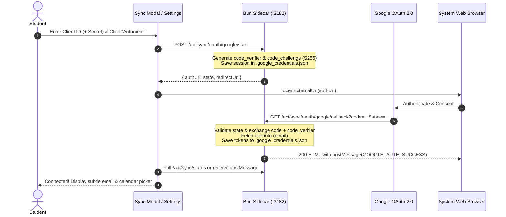

# Architecture Specification: CourseDeck (Desktop & Web)

## 1. Executive Summary & Vision

The **CourseDeck** is a high-performance, distraction-free study desktop and web platform that parses Independent Learning Centre (ILC) course packages into clean, structured Markdown, organizes them by unit and lesson, generates high-yield AI summaries and study notes, and provides interactive Ontario Curriculum (KICA)-aligned test materials.

All content is stored in a transparent, flat Markdown filesystem with zero external database dependencies. Inline editing is powered by the **CodeMirror 6** Markdown editor, allowing students to refine their notes and tests directly.

### Core Features:
1. **Courses Dashboard (`/`)**:
   - Course cards displaying course code, title, units, lesson count, and study resource indicators.
   - An upload card `[+]` allowing ingestion of course blocks (zip format or directory) into lessons and assets.
2. **Course Study Workspace (`/courses/[course_id]`)**:
   - **Lesson Navigation**: Header selector dropdown organized by Unit & Lesson with Previous / Next navigation.
   - **Study Tabs**:
     - **Full Lesson**: The parsed lesson content rendered with clean typography, GFM callout boxes (`[!NOTE]`, `[!TIP]`, `[!IMPORTANT]`), expandable suggested answers, and diagrams.
     - **Summary**: High-yield AI summary synthesizing core principles, legal definitions, and Ontario expectations.
     - **Cheatsheet**: Quick-reference table of key terms, etc.
     - **Practice Test**: Interactive quiz runner for Ontario KICA-aligned questions (Knowledge & Understanding, Thinking & Investigation, Communication, Application) with instant scoring, feedback, and rationale reveals.
   - **Inline CodeMirror Editor**: Toggle between rich reading view and live Markdown editing with instant auto-save to disk.
   - **Incremental Chapter Additions**: An `[+] Add Chapters` button in the workspace subheader allows uploading new lesson `.zip` archives directly to the active course. Existing customized notes and edits are strictly preserved while new chapters are parsed and indexed.
3. **Settings (`/settings`) & Prompts Engine**:
   - **Tabs**: Features a top-level tab bar with `[Settings]` (appearance, zoom, course storage, backup, supervisor check-in, maintenance), `[LLM]` (AI models configuration & providers), `[Prompts]` (prompt template management), and `[Integrations]` (Google Calendar integration, OAuth configuration, and MCP server tokens).
   - **AI Models (`/settings?tab=llm`)**: A list of model-provider cards (ZCode / Z.ai GLM, OpenCode, LM Studio, llama.cpp, Ollama, Gemini, OpenAI-compatible) with `[+] Add Model`, per-card test/edit/remove, and an **Active Model** dropdown. See §16.
   - **Prompts Management (`/settings?tab=prompts`)**: Template editor for course-wide and lesson prompts (summaries, cheatsheets, KICA tests, custom tabs) with dynamic placeholders (`{{lesson_title}}`, `{{content}}`, `{{unit}}`).
   - **Maintenance & Ingestion**: Manual re-index and image compression triggers.
4. **Study Schedules & Calendar Sync (`/schedules`)**:
   - Adaptive study schedule planning with custom study days, pacing targets, off-days, and exam deadlines.
   - Idempotent one-click synchronization to **Google Calendar** and ARC with OAuth 2.0 PKCE, deterministic event IDs, hash-based deduplication, and rate-limited batching. See §19.

---

## 2. High-Level System Architecture & Tech Stack

- **Runtime & Installer**: **Bun** (fastest package manager, script runner, and backend runtime)
- **Desktop Shell**: **Tauri v2** (`/tauri`) providing lightweight native macOS desktop windowing and file access
- **Frontend Framework**: **SvelteKit 5** with modern **Runes** (`$state`, `$derived`, `$props`, `$effect`) in `/app`
- **Styling**: **Tailwind CSS** with Typography plugin for clean, minimalist, high-legibility study aesthetics
- **Markdown & Code Editor**: **CodeMirror 6** (`@codemirror/lang-markdown`, `@codemirror/view`)
- **Extraction Engine**: Bun + **Cheerio** (DOM parsing & asset extraction) + **Turndown** with **GFM Plugin** (semantic Markdown conversion)
- **Data Persistence**: Flat filesystem in `/data` (Single Source of Truth, no database required)
- **Model Context Protocol (MCP)**: Native Streamable HTTP (`/mcp` on loopback `3182`) & Stdio (`--mcp-stdio`) integration via **`mcp-lite`**. See [`docs/mcp.md`](file:///Users/fil/Code/ilc-study-tool/docs/mcp.md) for full protocol specs and client configs.

### 2.1 Programming Style: No Compat Shims, No Migration

The codebase deliberately carries **no compatibility layers and no migration code**:

- **No compat shims**: no alternate formats, legacy branches, or "browser mode" fallbacks alongside the primary path. One clean, optimized implementation per feature, targeting the Desktop Tauri app and the Mobile Tauri app exclusively. When a mechanism is replaced (e.g., the base64-JSON sync bundle), the old path is deleted, not kept behind a flag.
- **No migration**: when a storage location or on-disk format changes (e.g., iPad courses moving to `Documents/courses`), stale data is not converted or relocated — users re-sync / regenerate. Legacy fallbacks for old filenames or paths are removed rather than accumulated.

Every rejected alternative that would require one of these (dual endpoints, format sniffing, data movers) is treated as a design smell: prefer changing the format once, cleanly, at the source. See §20.5 for how this applies to the sync architecture.

```
ilc-study-tool/
├── architecture.md             # Consolidated system architecture specification
├── package.json                # Root Bun package script coordinator
├── data/
│   ├── courses/
│   │   └── <course_id>/        # e.g., cou2m
│   │       ├── _backup/        # Original course HTML/ZIP archives
│   │       ├── meta.json       # Course metadata & units/lessons index
│   │       ├── assets/         # Extracted diagrams, images, and locker documents
│   │       │   ├── img/
│   │       │   ├── icons/
│   │       │   └── locker_docs/
│   │       ├── 01.02.lesson.md # Full lesson markdown
│   │       ├── 01.02.summary.md# High-yield study summary
│   │       ├── 01.02.cheatsheet.md # Quick reference cheatsheet
│   │       ├── 01.02.test.md   # Interactive KICA practice quiz
│   │       └── ...
│   └── prompts/
│       ├── summary.md          # Default prompt for lesson summarization
│       ├── cheatsheet.md       # Default prompt for cheatsheets
│       └── test_kica.md        # Default prompt for KICA question generation
├── app/                        # SvelteKit 5 + Tailwind App
│   ├── package.json            # Managed by Bun
│   ├── svelte.config.js        # SvelteKit 5 configuration
│   ├── vite.config.ts          # Vite configuration
│   ├── tailwind.config.ts      # Tailwind CSS configuration
│   └── src/
│       ├── lib/
│       │   ├── components/     # Svelte 5 components (Header, MarkdownViewer, CodeMirrorEditor, QuizRunner, UploadModal)
│       │   ├── parser/         # Extraction engine (Cheerio + Turndown + Asset pipeline + Incremental ingester)
│       │   └── server/         # File access repository and LLM service
│       └── routes/             # SvelteKit routes (+layout, /, /courses/[id], /schedules, /settings, /api)
└── tauri/                      # Tauri v2 Desktop App
    ├── Cargo.toml              # Tauri v2 dependency declarations
    ├── tauri.conf.json         # Tauri v2 window & build configuration
    ├── capabilities/           # Security & permission capabilities
    └── src/                    # Rust entrypoint
### 2.2 Key Directories & Codebase Map (Quick Reference)

To accelerate code navigation and prevent exhaustive searches across the codebase:

```
app/src/
├── lib/
│   ├── api.ts                  # Typed client apiFetch() and environment detection (isTauriEnvironment)
│   ├── tabs.ts                 # CANONICAL single source of truth for tab slugs, document filenames (tabFileName, courseDocFileName, docFileName), route parsing (parseDocFileName), and URL helpers (courseTabHref)
│   ├── checkpoint.ts           # Checkpoint domain models, 12-color sticky note palette, and color utilities
│   ├── preferences.ts          # User preferences (e.g. Return to most recent position in course) & route resolution
│   ├── llmProviders.ts         # Shared provider presets/protocols (LM Studio, llama.cpp, Ollama, Gemini, OpenAI-compatible)
│   ├── llmClient.ts            # Typed /api/llm client: model cards, active model, per-card connection test
│   ├── queueStatus.svelte.ts   # Reactive global queue poll store & task listeners
│   ├── scrollMemory.ts         # Legacy per-tab scroll offsets in localStorage (superceded by Checkpoint position tracking)
│   ├── theme.svelte.ts         # Light / Dark / System theme manager
│   ├── components/             # Reusable UI components
│   │   ├── Header.svelte           # Top application navigation bar (Courses, Checkpoints, Settings, Prompts)
│   │   ├── LessonSelector.svelte   # Unit & Lesson selector dropdown + prev/next controls
│   │   ├── PromptCard.svelte       # Prompt template inspection & re-generation trigger
│   │   ├── QuizRunner.svelte       # Interactive Ontario KICA practice quiz runner & scoring
│   │   ├── MarkdownViewer.svelte   # Rendered Markdown reader view with callout & image sizing
│   │   ├── CodeMirrorEditor.svelte # CodeMirror 6 markdown editor integration
│   │   ├── DocumentViewerModal.svelte # Fullscreen modal for viewing curriculum PDFs & diagrams
│   │   ├── UploadModal.svelte      # Course zip/mhtml ingestion modal (requires mandatory course code)
│   │   ├── AIQueuePopover.svelte   # Popover showing live background AI generation jobs
│   │   ├── FloatingCheckpointTrigger.svelte # Cursor-height floating trigger for creating note checkpoints
│   │   ├── CheckpointMarker.svelte # In-page persistent marker (color flag + subtle date)
│   │   └── CheckpointModal.svelte  # Modal dialog for creating and editing post-it checkpoint notes
│   ├── editor/                 # CodeMirror 6 Obsidian-style Live Preview extensions
│   │   ├── livePreview.ts          # Heading, bold, italic, link, list & table styling widgets
│   │   ├── frontmatter.ts          # Interactive YAML frontmatter Properties widget
│   │   └── table.ts                # GFM table interactive editor
│   ├── markdown/               # Markdown AST & pre-processing pipelines
│   │   ├── tableRepair.ts          # GFM table reconstructor (fixes multiline cells & stacked tables)
│   │   ├── mathRenderer.ts         # KaTeX pre-parser & currency protector (extractMath / restoreMath)
│   │   └── imageSpec.ts            # Image dimension, layout chip & icon detector
│   ├── parser/                 # Course extraction, HTML conversion, and frontmatter
│   │   ├── courseIngest.ts         # Course ingestion engine (creates lessons, summaries, manifest)
│   │   ├── archiveExtractor.ts     # Universal archive unpacker (.zip, .mhtml, .html)
│   │   ├── domCleaner.ts           # Cheerio DOM sanitizer (removes D2L chrome, extracts callouts)
│   │   ├── turndownConverter.ts    # Cheerio/Turndown Markdown converter with GFM plugins
│   │   ├── frontmatter.ts          # YAML parse/serialize (Bun.YAML with js-yaml fallback)
│   │   └── imageOptimizer.ts       # Bun.Image compressor for images > 512px
│   ├── pdf/                    # Client-side PDF generation pipeline (pdfmake)
│   │   ├── exportPdf.ts            # High-level PDF export coordinator
│   │   ├── compiler.ts             # Markdown to pdfmake AST compiler
│   │   └── theme.ts                # Ontario curriculum PDF styling, margins, colors
│   └── server/                 # Framework-agnostic backend services & API logic
│       ├── api.ts                  # handleApiRequest() — Single source of truth for ALL /api/* routes
│       ├── backup.ts               # Streaming zip backup export/import (createDataBackupZipStream)
│       ├── courses.ts              # CourseService (lessons, tab files, course-wide payload, checkpoints persistence)
│       ├── queue.ts                # GenerationQueue & worker for background AI jobs
│       ├── paths.ts                # Filesystem paths, DATA_DIR resolution, and path asserts
│       ├── llm.ts                  # Unified LLM client: multi-card store, active-model resolution, OpenAI-compatible + llama.cpp native transports
│       └── prompts.ts              # PromptService for template storage in data/prompts/
└── routes/                     # SvelteKit page routes
    ├── +layout.svelte              # Root shell with global navigation and theme initialization
    ├── +page.svelte                # Courses dashboard & library
    ├── checkpoints/                # Global Checkpoints hub (course cards layout like /schedules, newest-to-oldest)
    ├── checkpoint/                 # Route redirect to /checkpoints
    ├── prompts/                    # Global prompt templates editor
    ├── settings/                   # Data storage path, LLM config, backup/restore, re-indexing
    └── api/[...path]/+server.ts    # SvelteKit catch-all adapter delegating to api.ts

server/
└── index.ts                    # Standalone HTTP sidecar binary entry point (compiled to tauri/server)

tauri/
├── src/lib.rs                  # Rust entrypoint: window setup, sidecar process lifecycle, save_pdf_file
└── tauri.conf.json             # Tauri v2 bundle configuration and capabilities
```

---

## 3. Data Model & File Schemas

### 3.1 Course Manifest (`meta.json`)
```json
{
  "id": "cou2m",
  "title": "COU2M: Course Title",
  "grade": "Grade 10",
  "level": "University/College Preparation",
  "description": "Explores the content of this course.",
  "units": [
    {
      "number": 1,
      "title": "Unit 1 Course Content",
      "lessons": [
        {
          "id": "01.02",
          "code": "cou2m_u1la2",
          "title": "1.2 Insights into Content",
          "type": "lesson",
          "hasFull": true,
          "hasSummary": true,
          "hasNotes": true,
          "hasTest": true
        }
      ]
    }
  ]
}
```

### 3.2 Lesson Markdown (`<unit>.<lesson>.lesson.md`)
Carries YAML frontmatter for provenance and metadata:
```markdown
---
title: "Learning activity 1.2"
activityCode: "cou2m_u1la2"
courseId: "cou2m"
unit: "Unit"
unitNumber: 1
lessonNumber: 2
sourceUrl: ""
savedAt: "2025-09-30"
---

> [!NOTE] Learning Goals
> - Appreciate the fundamental principles of course
> - Explain what the concept "XYZ" means
> - Explain what factors influence the rule

## Minds On

> [!TIP] **Think**
> What's the difference between a X and Y?

...
```

### 3.3 Standardized Question Schema (`<unit>.<lesson>.test.md`)
Interactive practice tests follow human-readable Markdown with Ontario Secondary Curriculum (KICA) taxonomy:
```markdown
course: COU2M.01.02

# Lesson 02: Differentiating X from Y

## Questions
01) [Knowledge & Understanding] What is the fundamental difference between X and Y?
<Multiple-Choice>
- [ ] Statement 1.
- [ ] Statement 2.
- [ ] Statement 3.
- [ ] Statement 4.

--

02) [Thinking & Investigation] Going deeper into concepts of ZZZ?
<Multiple-Choice>
- [ ] Government mandates to increase tax revenue.
- [ ] Society's technological adoption changed public perceptions and behaviors regarding intellectual property.
- [ ] International treaties required eliminating all private copy rights.
- [ ] Supreme Court directives mandating digital obsolescence.

--

## Answers
01) B - (explanation) 
02) B - (explanation) 
```

### 3.4 Study Material YAML Frontmatter & Tab Schema
All generated study materials (`.summary.md`, `.cheatsheet.md`, `.test.md`, and custom tabs like `.assignment.md`) store their AI prompt instructions and metadata in standard YAML frontmatter (`--- ... ---`). Each lesson+tab has exactly **one** file — there is no versioning:

```markdown
---
prompt: |
  # ILC Lesson Summary Generation Prompt
  You are an expert Ontario Secondary School educator...
type: summary
updatedAt: '2026-10-14'
---

# Study Summary: Learning activity 1.2
...
```

#### Tab Files & Custom Tabs
- Every tab is a file: `<lessonId>.<tab>.md` (e.g., `01.02.summary.md`, `01.02.custom.md`, `01.01.assignment.md`).
- Tab slugs are lowercase alphanumerics/underscores (spaces in a typed name become `_`), validated by `TAB_SLUG_PATTERN` in `src/lib/tabs.ts` and `TAB_PATTERN` server-side.
- Beside **Practice Test**, a `[+]` button creates a custom tab for the current lesson (name prompt → slugified file, e.g. `01.02.custom.md`). Custom tabs carry their own prompt (seeded into `data/prompts/<slug>.md` on first use) and support edit, AI generation, and PDF export like the built-ins; a hover **×** deletes the lesson's file.
- Custom tabs are **per-lesson and file-driven**: the tab bar shows only tabs whose files exist for the open lesson. Visiting a URL like `/courses/<id>/02.03/assignment` when no file exists creates the tab automatically — this is how schedule deep links (`02.03/assignment` sections) open assignment-day work.
- **Navigation & Existence Verification**:
  - When switching between lessons: if the active tab is a custom tab, the app checks whether `<targetLessonId>.<tab>.md` exists on disk. If the file exists, the user stays on that custom tab; if absent, navigation gracefully falls back to **Lessons** (`.lesson.md`).
  - When switching to **Complete Course**: the system verifies if a corresponding course-level document exists (`course.<tab>.md`). If present, it navigates directly to that tab; if absent, it defaults to Complete Course Lessons (`/courses/<id>/course/lesson`) rather than attempting invalid document generation.
  - Course-level custom tabs (`course.<slug>.md`) are dynamically discovered by `CourseService.discoverCourseDocs()` and surfaced in the course mode tab bar alongside built-ins.
- Regeneration always overwrites the single file; the per-version pills and overwrite-vs-new-version choice were removed with versioning itself.

### 3.5 Reader Tab Scroll Memory (`tab_scroll:*`)
The course workspace scrolls inside a nested container, so the browser does not restore offsets between tabs. `src/lib/scrollMemory.ts` keeps them in `localStorage` instead — key `tab_scroll:<courseId>:<lessonId|course>:<tab>`, all lowercased (~40 bytes each):
- **A first visit to a tab/page opens at the top; later visits return to the remembered offset** — via tab click, lesson switch, course ↔ lesson scope toggle, browser Back, or reload alike.
- Offsets are written ~200 ms after scrolling pauses (flushed on `pagehide` and component teardown); offsets under 8 px are deleted rather than stored, so "at the top" and "never visited" behave identically.
- A floating **scroll-to-top** button (fixed bottom-right, shown once scrolled past ~400 px) smooth-scrolls the workspace back to the top.
- **Pruning:** archiving a course (`PUT /api/courses/:id/meta { archived: true }`) forgets all of that course's keys, and every courses-list load sweeps keys whose course no longer exists on disk. Offsets never reach the server, so pruning applies to the browser that performs the action.

---

## 4. Extraction & Ingestion Pipeline

The Bun extraction pipeline (`src/lib/parser/`):
1. **Archive Inspector**: Reads `.zip` files from `data/courses/<course_id>/_backup/` using **`fflate`** — a fast pure-JS zip codec chosen because it survives `bun build --compile` (native zip libs like `zip-bun` JIT-compile C bindings at runtime and crash inside compiled binaries; `adm-zip` compiles but is 5-10x slower).
2. **Asset Pipeline**:
   - Extracts images (`.jpg`, `.png`, `.svg`) to `data/courses/<course_id>/assets/img/`.
   - Extracts locker documents and PDFs to `data/courses/<course_id>/assets/locker_docs/`.
   - Deduplicates identical assets.
3. **Cheerio DOM Cleaner**:
   - Removes navigation wrappers, Brightspace D2L chrome, scripts, and trackers.
   - Extracts `#ilcLearningGoals` and formats into standard GFM callouts (`> [!NOTE]`).
   - Normalizes sections (`#mindsOn`, `#action`, `#consolidation`) into semantic markdown headings.
   - Converts interactive answer reveal buttons (`.btn-answer-reveal`) into native collapsible `<details><summary>Suggested Answer</summary>...</details>`.
   - Rewrites image and document `href`/`src` paths to local relative asset paths.
4. **Turndown Markdown Converter**:
   - Uses `turndown` + `turndown-plugin-gfm` to generate crisp Markdown.
   - Enforces single-line table cell formatting (`tableCellLineBreaks` rule) by mapping inner `<br>` and `<p>` breaks to `<br>` tags rather than raw newlines that violate GFM table specifications.
   - Pipes output through `repairMarkdownTables` before serialization to guarantee all tables are GFM-compliant.
   - Preserves tables, callouts, lists, and KaTeX mathematical notation.
   - YAML frontmatter is written with the **`Bun.YAML`** runtime builtin (parse + stringify; note: `stringify` emits flow style with no trailing newline, so serializers append `\n` before the closing `---`).
5. **Study Suite Synthesizer**:
   - Generates initial high-yield `summary.md`, `cheatsheet.md`, and `test.md` aligned with the Ontario curriculum expectations.
6. **Image Optimizer** (`src/lib/parser/imageOptimizer.ts`, runs at the end of every ingest):
   - Any raster image wider than **512px** is resized (aspect preserved) and re-encoded as **JPEG q82** via the **`Bun.Image`** runtime builtin — no native npm dependency, so it works inside the compiled sidecar binary.
   - Markdown references are rewritten to the new `.jpg` filenames, Pandoc `{width=…}` attributes are normalized to pipe syntax, and any image that would display wider than 50% of the reading column gets an explicit `|50%` spec.
   - Also exposed via `POST /api/maintenance/compress-images` (Settings → "Compress Course Images") and `bun run scripts/compress_course_images.ts`.

---

## 5. Incremental Chapter & Lesson Ingestion

When new course chapters or lessons are added:
1. **Targeted Ingestion**:
   - New `.zip` archives are saved to `data/courses/<course_id>/_backup/`.
   - The ingester checks each lesson file: if `${lessonId}.lesson.md` already exists, it is **preserved** to prevent overwriting student notes, user edits, or custom summaries.
   - Only newly added lesson archives are extracted, parsed into markdown, and populated with initial study summaries, cheatsheets, and tests.
2. **Manifest Synchronization**:
   - Existing metadata (custom titles, descriptions, unit names) in `meta.json` is preserved.
   - New lessons are categorized into their corresponding units (or new units are created dynamically).
   - The frontend dropdown updates immediately to show the newly available chapters.

---

## 6. CodeMirror 6 & Svelte 5 Lifecycle Integration

In Svelte 5, reactive effects (`$effect`) track all synchronous signals read within them. To avoid cursor-jumping and editor re-instantiation on keystrokes:
1. **Single Mount Lifecycle**:
   - `EditorView` is created strictly inside `onMount` (or `untrack`). It is instantiated once and destroyed only when unmounting.
2. **Keystroke Synchronization Guard**:
   - As the user types inside CodeMirror, `EditorView.updateListener` updates an internal tracking variable `lastValue` before invoking `onChange(newDoc)`.
   - When the parent's reactive state changes in response, the component's `$effect` checks `if (val !== lastValue)`. Because `val` matches `lastValue`, CodeMirror is NOT modified from the outside, preserving the user's cursor position and undo history seamlessly.
3. **External Prop Changes**:
   - When switching tabs (e.g. from `lesson` to `summary` or changing lessons), `val !== lastValue` evaluates to true, dispatching the document change and preserving or clamping the selection.

---

## 7. Tauri v2 Desktop Runner & Commands

The project root coordinates both the SvelteKit 5 web app and Tauri v2 desktop application through Bun:
- `bun run dev`: Runs Vite dev server for web testing (`http://localhost:5173`).
- `bun run build`: Typechecks and builds production bundles via SvelteKit.
- `bun run parse`: Executes the Bun ingestion engine on `data/courses/` archives.
- `bun run tauri:dev`: Builds the SvelteKit app and launches the native Tauri v2 macOS desktop window.
- `bun run check`: App svelte-check **plus** `tsc --noEmit` over `server/index.ts` and shared server modules (root `tsconfig.json`, `@types/bun`) — a broken sidecar can never pass CI.
- `bun run test`: Sidecar API contract tests (`scripts/api-contract.ts`) plus the PDF pipeline smoke test.
- `bun run server:compile`: Produces the standalone sidecar binary `tauri/server` (`.exe` on Windows) via `bun build --compile`.
- `bun run tauri:build:win` / `tauri:build:mac`: Platform bundles (`--bundles nsis` / `dmg`); `bundle.resources: ["server*"]` picks up whichever binary name the platform produced.

### 7.1 Backend Sidecar & the Single API Layer
Packaged desktop builds have no SvelteKit server, and the dev/web app has no compiled sidecar — both serve the **same HTTP API from one implementation**:
- **`app/src/lib/server/api.ts`** exports a framework-agnostic `handleApiRequest(req, url) → Response` covering every endpoint (courses, lessons, assets, queue, prompts, LLM, parse/ingest, course-docs, backups, storage/theme settings, image compression). It is the *only* place endpoint logic lives.
- **SvelteKit side**: a single catch-all adapter (`src/routes/api/[...path]/+server.ts`, 3 lines per verb) delegates to the shared handler during `bun run dev` and web builds.
- **Sidecar side**: `server/index.ts` compiles to a standalone executable (`tauri/server` / `server.exe`) and delegates to the same handler, adding only the loopback transport, CORS for Tauri webview origins, and SPA static serving. If its port is already owned by another instance it exits cleanly instead of crashing.
- **Frontend**: `apiFetch(path, init)` (`app/src/lib/api.ts`) applies the environment base URL (dev server vs `http://127.0.0.1:3182`) at every call site. The old global `window.fetch` monkey-patch (`initApiInterceptor`) is gone; `isTauriEnvironment()` is the single environment detection export.
- **Compiled-binary-safe dependencies only**: `Bun.Image` (compression), `Bun.YAML` (frontmatter), `fflate` (zip). Native npm modules (sharp, zip-bun) cannot load inside `bun build --compile` executables and must not be added to this path.
- **Hardened spawn** (`tauri/src/lib.rs`): per-platform binary lookup (`server`/`server.exe` in resources and beside the executable, bun fallback including `%USERPROFILE%\.bun\bin\bun.exe`), stdout/stderr captured to `<data_dir>/backend.log`, spawn failures logged, and the main window is held back until the backend port answers (10s cap) so the UI never appears before the API is reachable.
- **Loopback-only**: the sidecar binds `127.0.0.1` and emits CORS headers solely for recognized origins (localhost/127.0.0.1 ports and the Tauri webview origins `tauri://localhost` / `http://tauri.localhost`).

### 7.1b Windows Portable Build (`bun run tauri:build:portable`)
Runs **on Windows only** (gated with a clear message elsewhere). Produces in `tauri/target/release/bundle/portable/`:
- **Primary artifact**: `Course-Study-Tool-<version>-portable-win-x64.zip` (+ `.sha256`) containing the renamed release exe, `server.exe`, and `README-Portable.txt` (WebView2 requirement, data location, update instructions). Unzip anywhere and run — data lives in `data/` beside the exe.
- **Secondary artifact** (only if NSIS/makensis is present): a single-file silent launcher. Convenience only — unsigned NSIS self-extractors are a common antivirus false-positive pattern and re-extract ~90MB on every launch; distribute the zip to other machines.
- The build skips the frontend `beforeBuildCommand` via a temporary `tauri.portable.conf.json` override (the caller builds it once).

Data-directory resolution order (Rust, `get_default_data_dir` / `find_course_dir`): settings `data_dir` → `DATA_DIR` env → `cwd/data` → `cwd/../data` → **`<exe-dir>/data`** (portable layout; checked after cwd so the NSIS launcher's `$EXEDIR` cwd still wins over its `%TEMP%` extraction dir) → app-data dir.

### 7.2 Verification gates (root scripts)
- `bun run check` — app svelte-check **plus** `tsc --noEmit` over the sidecar and shared server modules.
- `bun run test` — three suites: `scripts/api-contract.ts` (response-shape contracts), `scripts/sidecar-e2e.ts` (ingest → save → save-as-new-version → course-docs → theme → backup roundtrip against a live sidecar on scratch data), and the PDF pipeline smoke test.

### 7.3 Audit findings — resolution status
- ✅ **Sidecar type errors / contract drift** (queue `addTasks`, `getAllPrompts`, `collectLessonDocs`, missing `/api/parse`, `saveLessonTab` signature, duplicate `success` key): fixed, and structurally prevented going forward — dev server and sidecar now share one handler (`api.ts`).
- ✅ **Frontmatter parsing** (YAML frontmatter + 25-line title scan): fixed; frontmatter is read/written with `Bun.YAML` (round-trip covered by e2e).
- ✅ **Fetch monkey-patch** (`initApiInterceptor`): removed; replaced by typed `apiFetch` at all 34 call sites.
- ⏳ **CSP `script-src 'unsafe-inline'`** (`tauri.conf.json`): known weakness, kept as a follow-up (needs SvelteKit nonce/hash-based CSP support).
- The full historical audit log with per-item detail remains in `docs/improvements.md`.

---

## 8. In-Place Text Selection & AI Post-It Note Annotations

Students reading any course material (Full Lesson, Summary, Cheatsheet) can highlight or select text to ask contextual AI questions and attach persistent notes directly to the Markdown document.

### 8.1 Workflow & Interaction Model
1. **Highlight & Floating Trigger**:
   - Selecting text within the reader pane activates a floating `[ ✨ Ask AI ]` pill positioned at selection coordinates.
   - Clicking opens an AI query modal with an excerpt preview, custom question input, and 4 quick Ontario prompt chips (*"Explain simply"*, *"Why significant?"*, *"Exam takeaway"*, *"Real-world example"*).
2. **Context-Aware Prompting**:
   - The request dispatches to `/api/llm` with `sessionId: "${courseId}-note"`.
   - The model receives the full lesson material as background context while prioritizing the specific excerpt and the student's question.
3. **Markdown Callout Storage**:
   - The answer is inserted after the annotated paragraph as a standard GFM callout:
     ```markdown
     > [!USERNOTE] Why is this principle significant in XY?
     > <!-- target: "statutory discretion must be exercised in good faith" -->
     > **Concept XYZ** deeper explanation here...
     ```
   - Standard GFM callout syntax guarantees 100% interoperability with external Markdown editors and the built-in CodeMirror editor.
4. **Interactive Reader View & Bidirectional Highlighting**:
   - In reader mode, the note renders as a warm amber Post-It note card.
   - The target snippet in the paragraph above is underlined with a dotted amber anchor (`<mark class="ai-note-anchor">`).
   - Hovering over either the post-it note or the anchor text triggers synchronized highlighting.
   - Clicking the anchor text smoothly scrolls to and expands the post-it note.
   - Each note includes an inline `[✕]` action allowing instant deletion with disk synchronization.

---

## 9. Full-Page Document & PDF Viewer (`DocumentViewerModal`)

When students click links to curriculum PDF worksheets, reference documents (e.g., *Canadian Charter of Rights and Freedoms* in `assets/locker_docs/`), or diagrams in the lesson Markdown:
1. **In-App Full-Page Overlay**:
   - Instead of navigating the entire browser or Tauri webview away from the study workspace, the click is intercepted.
   - Opens a dedicated, full-screen document overlay (`DocumentViewerModal.svelte`).
2. **Persistent Header Controls**:
   - Displays the document title, file type badge (`PDF Document` / `Image`), and course title.
   - Includes a **`[Back]`** button and a prominent **`[✕ Close]`** button that returns directly to the exact lesson scroll position.
   - An external **`[Download]`** button allows saving the file or opening it in native desktop PDF viewers (Preview, Adobe Acrobat).
3. **Multi-Modal Dismissal**:
   - Students can dismiss the viewer and return to the lesson via:
     - The top-bar **`[✕ Close]`** or **`[Back]`** button.
     - The **`Escape`** keyboard shortcut.
     - Browser or mouse back navigation (integrated with HTML5 `history.pushState` and `popstate` events).

---

## 10. Multi-Format Lesson Ingestion Engine (.zip, .mhtml, .html)

To support courses where lessons cannot be directly downloaded as standard SCORM packages, the ingestion engine seamlessly accepts browser-saved formats:

### 10.1 Supported File Types
1. **Standard Zip Packages**:
   - `cou2m_u1la2.html.zip` (original course package format).
2. **Browser-Saved "Webpage, Complete" Zip Archives**:
   - `<Title>.html` or `<Title>.htm` paired with `<Title>_files/` directory zipped together (e.g. `Learning activity 1.1 Introduction to XYZ.zip`).
   - Automatically detects and parses inner `intermediate.html` SCORM iframes.
   - Extracts all local images, SVGs, and PDFs from `_files/` into standardized `assets/img/`, `assets/icons/`, and `assets/locker_docs/`.
3. **Single File Web Archives (.mhtml / .mht)**:
   - MIME multipart documents saved directly via Chrome, Edge, or Safari (e.g. `Learning activity 1.2_ Types of widgets.mhtml`).
   - Parses multipart boundaries, quoted-printable text, and base64-encoded binary attachments.
   - Extracts embedded diagrams and illustrations directly to disk and normalizes image `src` references.
4. **Standalone HTML Files & Companion Folders**:
   - `.html` files placed alongside companion `_files` directories.

### 10.2 Robust Unit & Lesson Metadata Resolution
- Resolves unit numbers, lesson numbers, activity codes, and titles across divergent naming conventions (`u1la1`, `Learning activity 1.1`, `1.2 Types of widgets`, or internal SCORM manifests).
- Automatically converts root-level package files in `data/courses/<course_id>/` into `_backup/` for clean revision history and persistence.

---

## 11. Image Resizing & Interactive Scaling Controls

Lesson content imported from brightspace or web downloads often contains oversized diagrams, balance sheets, and high-resolution screenshots that disrupt the reading flow. The tool provides both standard Markdown syntax extensions and interactive on-the-fly reader controls:

### 11.1 Markdown Sizing Syntax Conventions
1. **Obsidian / Logseq Pipe Syntax**:
   - `` -> Fixed width `300px`
   - `` -> Responsive width `50%`
   - `` -> Width `400px`, height `250px`
   - `` -> Named preset (`xs`: 160px, `sm`/`small`: 280px, `md`/`medium`: 480px, `lg`/`large`: 720px, `xl`/`full`: 100%)
   - `` -> Key-value parameters
2. **Pandoc / Markdown-it Attribute Syntax**:
   - `{width=350px}`
   - `{50%}`
   - `{400x250}`
3. **Standard HTML**:
   - `` or `style="width: 50%;"`

### 11.2 Interactive Reader Controls
1. **Sensible Default Constraints**:
   - Unconstrained images default to `max-height: 480px; width: auto; object-fit: contain;` centered within the reading pane, preventing tall or ultra-wide images from overwhelming the lesson text.
2. **Floating Quick-Scale Toolbar**:
   - Hovering over any content image presents a floating action pill in the top-right corner:
     `[ Size: Auto | 25% | 50% | 75% | 100% | ⛶ Full ]`
   - Clicking a percentage chip (`25%`, `50%`, `75%`, `100%`) dynamically resizes the image immediately in real-time.
   - Clicking `Auto` resets the image to the default balanced container fit.
   - Tooltips on each chip display the corresponding Markdown syntax to make learning the syntax seamless.
3. **Full-Page Zoom & Inspection**:
   - Clicking **`[⛶ Full]`** or clicking directly on the image opens it in the full-page `DocumentViewerModal`, enabling pan/zoom, high-detail inspection, and downloading.
4. **Intelligent Icon Detection**:
   - SVG icons, buttons, and badges (`assets/icons/`, `think.svg`, `rubric_button.svg`) are automatically styled inline without giant margins or scale toolbars, keeping curriculum navigation crisp and uncluttered.

---

## 12. CodeMirror Live Preview (Obsidian-Style WYSIWYG Editor)

Adapted from the architecture in `nuza`, the CodeMirror editor (`app/src/lib/editor`) provides an **Obsidian-style Live Preview** writing experience directly in the study tool:

### 12.1 Interactive In-Place Markdown Rendering
1. **Headings (`#`, `##`, `###`)**:
   - Render with authentic proportional scale, weight, and hierarchy.
   - When the cursor is off the line, the leading `#` hashes disappear.
   - Placing the caret anywhere on the line reveals the `#` hashes dimmed (`cm-md-mark`), allowing immediate editing without breaking layout.
2. **Inline Formatting (Bold, Italic, Strikethrough, Inline Code)**:
   - Formatted inline as rich text (`**bold**` as bold, `*italic*` as italic, `` `code` `` as a styled chip).
   - Markdown markers fold away when not selected and reveal smoothly when the cursor touches the word or line.
3. **Links (`[title](url)`)**:
   - Rendered as blue styled links with subtle underlines.
   - The URL and brackets hide when the cursor is elsewhere.
   - **Mod-Click** (`Cmd-Click` on macOS, `Ctrl-Click` on Windows/Linux) opens links in a new browser tab.
4. **Lists & Tasks**:
   - Bullet items (`- `, `* `) render with clean glyphs (`•`, `◦`, `▪`).
   - Tasks (`- [ ]`, `- [x]`) render as interactive, clickable checkboxes. Clicking the checkbox toggles `[ ]` $\leftrightarrow$ `[x]` directly in the underlying Markdown text with smooth animated transitions.
   - Checked tasks automatically gain line strikethrough.
   - Pressing **`Enter`** automatically continues the list or task, and renumbers ordered lists. Pressing **`Enter`** on an empty item cleanly exits the list.
5. **Interactive GFM Tables**:
   - Render as formatted HTML tables with borders, headers, and column alignments.
   - Clicking any cell turns it into an editable field right inside the table, saving changes back to the Markdown document. Double-clicking reveals the raw Markdown table.
6. **Images (``)**:
   - Render live inside the editor with support for both web URLs and course assets (`./assets/...` resolved to `/api/courses/${courseId}/assets/...`).
   - Respects Obsidian pipe sizing (``, ``).
7. **YAML Frontmatter (`---`)**:
   - Renders as a structured Properties form displaying key-value metadata, with inline editing, deletion, and property additions. Placing the cursor inside reveals the raw YAML text.
---

## 13. Course-Wide Synthesis & Document Architecture

In addition to lesson-by-lesson study materials, the platform provides complete course-wide synthesis documents (`course.summary.md`, `course.cheatsheet.md`, `course.test.md`) accessible via the **Complete Course** scope in the workspace header.

### 13.1 Filesystem Layout & Storage Model
Course-wide documents are stored at the root of the course directory:
- `data/courses/<course_id>/course.summary.md`: Comprehensive cross-unit executive summary and curriculum synthesis.
- `data/courses/<course_id>/course.cheatsheet.md`: Unified master quick-reference table of core terminology, legal principles, and formulas.
- `data/courses/<course_id>/course.test.md`: Full course practice exam spanning all units, aligned with Ontario KICA curriculum categories.

Unlike lesson-level study materials which support multi-version branching (`.summary-2.md`, etc.), course-level documents are maintained as single consolidated artifacts (`versions.length === 0`). Re-generating a course-level document directly updates the master artifact without prompting for version branching.

### 13.2 Curated Aggregation Engine (`CourseService.buildAggregatedPayload`)
Generating high-yield course-wide materials requires synthesizing insights across all units without overloading the LLM's context window with repetitive lesson text or navigational boilerplate.

1. **Curated-Only Sourcing Principle**:
   - The aggregation engine **strictly excludes uncurated raw course materials (`.lesson.md`)**.
   - Synthesis is constructed exclusively from student-curated and refined study materials (`.summary`, `.cheatsheet`, and `.test.md`).
2. **Selective Type Priority**:
   - **For Course Practice Tests (`type === 'test'`)**:
     - Gathers the latest `.summary.md` (or highest version `.summary-N.md`) for each lesson.
     - Falls back to `.cheatsheet.md` if no summary is available.
     - Scans existing lesson practice tests (`.test.md`) and extracts question prompts and covered quiz topics into an `#### Existing Lesson Quiz Coverage` section. This provides the LLM with direct visibility into already-tested competencies to ensure comprehensive cross-unit coverage without duplicating lesson-level questions.
   - **For Course Summaries (`type === 'summary'`)**:
     - Collects the latest lesson summaries, falling back to cheatsheets.
   - **For Course Cheatsheets (`type === 'cheatsheet'`)**:
     - Collects the latest lesson cheatsheets, falling back to summaries.
3. **Context Window & Character Budgeting**:
   - YAML frontmatter is stripped via `parseFrontmatter` so only clean Markdown content enters the prompt payload.
   - Per-lesson character limits are enforced (`budgetLessonContent`):
     - **Test synthesis**: 2,200 characters per lesson.
     - **Summary synthesis**: 3,000 characters per lesson.
     - **Cheatsheet synthesis**: 2,500 characters per lesson.
   - If no curated study materials exist across any lesson in the course, the engine returns an empty payload, prompting a descriptive error instructing the student to generate or curate lesson summaries first.

### 13.3 YAML Frontmatter Prompt Provenance & Single Source of Truth
Every generated course artifact preserves its exact generation instructions in YAML frontmatter (`--- ... ---`):

```markdown
---
prompt: |
  # Course-Wide Practice Exam Generation Prompt
  Generate an extensive 24-question Ontario KICA-aligned exam...
type: course_test
updatedAt: '2026-10-08'
---

# Course Practice Test: COU2M
...
```

1. **Definitive Provenance**:
   - The YAML frontmatter `prompt` field is the single source of truth for the exact prompt instructions used to produce that specific document.
   - When a user customizes a prompt in the UI (for instance, changing the question count from 12 to 24), the backend explicitly serializes `prompt: systemPrompt` *after* any parsed frontmatter defaults, guaranteeing that custom user prompts are never clobbered by LLM-emitted frontmatter blocks.
2. **Frontend Synchronization & Diffing**:
   - In `PromptCard.svelte` and `+page.svelte`, the active prompt is loaded directly from the document's frontmatter.
   - A `defaultPrompt` prop supplies the base prompt template. The UI computes `isModified = cardPrompt.trim() !== defaultPrompt.trim()`, allowing the "Prompt modified" badge and "Reset" action to accurately reflect customizations against default templates.
   - Upon successful generation, the response Markdown (with updated frontmatter) immediately updates both `tabContents` and `originalContents`, keeping the editor, prompt card, and quiz runner in sync.

### 13.4 Resilient LLM Execution & Extended Timeouts
Synthesizing multiple units into high-question-count exams (e.g., 24 KICA questions + detailed explanations) requires extended generation windows:
- `LLMService.generateResult` accepts an optional `timeoutMs` parameter governing both the `AbortController` and the `Promise.race` deadline timer. The effective per-attempt deadline is resolved as: per-call `timeoutMs` override → the **Request Timeout** in Settings (stored config `timeoutSeconds`, selectable 30/60/90/120/150s) → built-in default of **150 seconds** (raised from 90s; timeout errors name the setting so users can self-serve).
- The background queue's schedule task keeps a dedicated **300-second (5-minute) per-attempt budget** (via a per-call override) because schedule prompts aggregate the whole course; the Settings knob can only raise that floor, never lower it.
- The UI reflects asynchronous status with inline spinners (`<Loader2 class="animate-spin" />`) and disabled button states, resetting interactive quiz state cleanly upon document replacement. The course-docs poll loop reports last-known status/elapsed time in its timeout message and clarifies that the background job continues and usually completes — check the AI Queue or reload.

---

## 14. High-Capacity Streaming Backup & Migration Architecture

The backup and migration system (`/api/backup/export` and `/api/backup/import`) provides full portability across platforms and machines. Because course materials and media assets can grow up to **2,000MB+**, the architecture is engineered to prevent network timeouts, event-loop freezes, and out-of-memory crashes.

### 14.1 Architecture for Scale (Up to 2,000MB+)

1. **Web-Standard `ReadableStream` Output**:
   - `createDataBackupZipStream` (`src/lib/server/backup.ts`) produces a standard `ReadableStream<Uint8Array>` consumed by `new Response(stream)`.
   - The server emits HTTP `200 OK` and response headers (`Content-Type: application/zip`) immediately (< 5ms). This immediately cancels the WebKit/browser resource timeout timer (which triggers if no response headers arrive within 30-60 seconds).
2. **Selective Pass-Through vs. Deflate Compression**:
   - Compressing already-compressed files (`.zip`, `.png`, `.jpg`, `.pdf`, `.webp`) with standard DEFLATE wastes enormous amounts of CPU cycles without reducing file size.
   - The backup engine uses **`ZipPassThrough`** for binary files matching `/\.(zip|gz|png|jpg|jpeg|webp|pdf|mp4|mp3|woff2|woff)$/i`. It streams them with zero compression overhead while computing standard zip CRC32.
   - Text files (`.md`, `.json`, `.txt`, `.html`, `.svg`) use **`ZipDeflate`** at `level: 1` (fastest compression), completing in milliseconds.
3. **Non-Blocking Event-Loop Yielding**:
   - During large archive generation, synchronous looping would freeze the single-threaded Node/Bun event loop.
   - The archiver yields every 20 files (`await new Promise(r => setTimeout(r, 0))`), allowing concurrent HTTP requests—such as frontend `/api/queue` polling—to be accepted and serviced instantly with 0ms delay.
4. **Default Exclusion of Raw Upload Archives (`_backup/`)**:
   - When courses are ingested, the original `.zip` or `.mhtml` upload packages are archived in `data/courses/<course_id>/_backup/`. These raw archives typically account for 70–80% of total course disk space.
   - By default, `/api/backup/export` **excludes** the `_backup/` folder, producing a lean, high-speed export containing 100% of the lessons, markdown notes, prompts, AI summaries, cheatsheets, interactive quizzes, assets, and app settings.
   - A checkbox in Settings (`Include raw package backups`) allows users to include `_backup/` (`?includeRaw=true`) whenever a full byte-for-byte archival mirror is required.
5. **Dual Console & UI Progress Telemetry**:
   - **Server Console**: Logs real-time archiving progress (`[Backup Export] Progress: X/Y (Z%) - <file>`).
   - **Client Console & UI**: The browser reads the incoming stream with `res.body.getReader()`, updating both the browser `console.log` (`[Backup Export] Streamed X MB so far...`) and the UI button badge (`Exporting (X.X MB)...`).
   - **Tauri Memory Safety**: For archives larger than 25MB, Tauri downloads fall back to streaming `URL.createObjectURL(blob)` instead of buffering gigantic base64 strings in memory.

### 14.2 User-Driven Course Ingestion (No Hardcoded Course Metadata)
The course ingestion pipeline (`CourseIngest` in `src/lib/parser/courseIngest.ts`) is strictly dynamic:
- **Mandatory User Input**: New courses require an explicit, user-supplied course code (e.g., `MCR3U`, `CLU3M`, `ENG4U`).
- **No Mock Defaults**: Ingestion contains zero hardcoded course codes, mock curriculum titles, or fake unit names.
- **Dynamic Unit Discovery**: Unit titles are extracted from the uploaded course content or preserved from existing `meta.json` manifests, falling back to clean numeric identifiers (`Unit 1`, `Unit 2`, etc.).

---

## 15. Markdown Parsing, Math & Table Normalization Architecture

Because ILC course materials span diverse disciplines—from high-density algebra and calculus (MCR3U) to accounting balance sheets (BAF3M) and legal case studies (CLU3M)—the Markdown rendering pipeline must handle mathematical notation, financial currency, complex tables, and multimedia attributes without syntax corruption.

### 15.1 Multi-Stage Rendering Pipeline

The rendering lifecycle in both the on-screen reader (`MarkdownViewer.svelte`) and the PDF compiler (`pdf/markdown/preprocess.ts`) follows a strict multi-pass pipeline:

1. **Frontmatter Stripping**: Strips YAML frontmatter blocks (`--- ... ---`) so only document body text is parsed.
2. **Pandoc Attribute Normalization**: Converts `{width=300px}` into pipe-delimited image specs (``).
3. **Asset Route Rewriting**: Rewrites relative `assets/` paths into active API URLs (`/api/courses/:id/assets/...`).
4. **Callout & Post-It Isolation**: Extracts `> [!NOTE]` callouts and `> [!USERNOTE]` AI study notes into structured blocks, substituting them with collision-proof markers (`%%%USERNOTE_N%%%` or `%%%PDFBOX_N%%%`).
5. **Table Normalization (`tableRepair.ts`)**: Reconstructs broken multiline tables, balances columns, and separates stacked tables before Markdown tokenization.
6. **Pre-Parsing Math Extraction (`mathRenderer.ts`)**: Detects LaTeX expressions (`$$...$$`, `\[...\]`, `\(...\)`, `$formula$`, `(formula)`) and substitutes them with `%%%MATH_TOKEN_N%%%` tokens. This shields LaTeX backslashes (`\(`) and underscores (`x_1`) from CommonMark parsers.
7. **Marked GFM Parsing (`markedParser.parse()`)**: Parses the cleaned, math-isolated Markdown into clean HTML / AST tokens with GitHub Flavored Markdown rules.
8. **KaTeX Formula Restoration (`restoreMathTokens`)**: Replaces math tokens with server-rendered KaTeX HTML (`katex.renderToString()`).
9. **Component Re-Injection & Sanitization**: Restores callouts/post-its and runs DOMPurify with whitelisted tags (`<details>`, `<summary>`, `<mark>`).

---

### 15.2 Critical Parsing Gotchas & Rules to Watch Out For

#### 1. GFM Single-Line Table Constraint vs. Multiline Ingestion
- **The Pitfall**: HTML course rubrics and activity tables frequently contain `<br>` or `<p>` tags within `<th>` and `<td>` cells (e.g., `<th>Level 4<br>(80 – 100%)</th>` or multiline criteria descriptions). When Turndown's standard GFM plugin converts these, it emits literal raw newlines (`\n`) between table pipes.
- **The Consequence**: CommonMark and GFM specifications (§4.10) mandate that **every table row must be a single continuous line**. If unescaped newlines appear between pipes, Marked's table tokenizer fails and falls back to rendering the entire table as fragmented paragraph `<p>` tags with raw markdown pipes.
- **The Solution**:
  - `repairMarkdownTables` (`app/src/lib/markdown/tableRepair.ts`) scans for delimiter lines (`| --- | --- |`), looks backward to reconstruct multiline headers, and looks forward to collapse multiline body cells into single-line rows with `<br>` tags.
  - In `turndownConverter.ts`, the `tableCellLineBreaks` rule maps inner cell line breaks to `<br>` during ingestion.

#### 2. Stacked Adjacent Tables with Differing Columns
- **The Pitfall**: In accounting courses (such as BAF3M 02.05), a 2-column header table (`| General Journal | Page 3 | \n | --- | --- |`) is often immediately followed on the next line by a 5-column ledger table (`| Date 20-- | Accounts... | P.R. | Debit | Credit | \n | --- | --- | --- | --- | --- |`) without an empty separating line.
- **The Consequence**: Markdown tokenizers treat the second table's header and delimiter as continuation rows of the first table, destroying table structure.
- **The Solution**: `repairMarkdownTables` inspects upcoming lines for new delimiter rows with different column schemas and automatically inserts separating blank lines.

#### 3. Strict Accounting Currency vs. Math LaTeX Protection
- **The Pitfall**: Standard LaTeX dollar math (`$...$`) naive regexes mistake financial figures (e.g., `$1,500 and then $2,500`, or `$30,000 to $45,000`) for math delimiters, corrupting currency values into broken equation syntax.
- **The Defense**: `isLikelyInlineMath` (`app/src/lib/markdown/mathRenderer.ts`) enforces strict structural heuristics:
  - Digit-leading expressions (`$30^\circ$`) are ONLY accepted if they contain structural LaTeX operators (`\command`, `^`, `_`, `{}`).
  - Plain digit/comma sequences (`$1,500`, `$45,000.00`) are immediately rejected as currency.
  - Financial prose keywords (`revenue`, `assets`, `inventory`, `cash`, `debt`, `and`, `then`, `cost`, `per hour`) force content to remain literal text.

#### 4. Pre-Extraction Shields CommonMark from Corrupting LaTeX
- **The Pitfall**: Marked's default tokenizer treats `\(` as an escaped parenthesis `(`, stripping the backslash and destroying `\frac`, `\alpha`, or `\sqrt` commands. Furthermore, subscripts like `x_1 + x_2` are misparsed into italic `<em>` tags.
- **The Defense**: `extractMathFromMarkdown` extracts math *before* Marked processes the string, replacing formulas with inert tokens (`%%%MATH_TOKEN_N%%%`). KaTeX renders the math *after* Marked completes.

#### 5. Code Block Shielding
- **The Rule**: Any pre-processor that scans for pipes, math dollars, or markdown markers must first protect code blocks (fenced ```...``` and inline `...`) with placeholders (`%%%TABLE_CODE_N%%%` / `%%%MATH_CODE_N%%%`). Code snippets illustrating markdown, shell scripts, or programming syntax must never be altered by table or math normalizers.

#### 6. Escaped Pipes in Table Cells
- **The Rule**: Table cells containing literal pipes must escape them as `\|`. The helper `splitTableCells` respects escaped pipes when parsing cells so column counts remain accurate.


---

## 16. Multi-Model Provider Cards & Active-Model Routing

Students mix cloud and local models (an LM Studio box at home, a llama.cpp server on the study desktop, a cloud key for heavy course-wide exams). Settings → **AI Models** manages them as **model cards**; exactly one card is **active**, and every AI feature runs through it.

### 16.1 Store & Active Resolution
- Persisted in `data/llm_config.json` as a versioned store: `{ version: 2, activeId, cards: [ { id, label, provider, baseUrl, apiKey, authHeaderType, model, temperature, timeoutSeconds } ] }`.
- Legacy installs (flat single-config JSON) are migrated on read into one card, active — no user action required.
- `LLMService.loadStoredConfig()` resolves the **active card** and is the single routing point: the queue worker, schedule enrichment, course-doc generation and the `/api/llm` generate action all obtain their config there. Switching the Active Model in Settings therefore reroutes every feature — including work already sitting in the queue — without touching call sites.
- API keys live per card. `GET /api/llm` never returns a key (only `hasApiKey`); `POST save_store` keeps a card's stored key whenever the submitted key field is blank.

### 16.2 Provider Protocols
Provider presets live in the dependency-free `app/src/lib/llmProviders.ts`, shared by the server transport layer and the Settings UI:
- **OpenAI-compatible** (`/v1/chat/completions` or `/paas/v4/chat/completions`, `messages` array): OpenAI, **ZCode / Z.ai GLM** (`https://api.z.ai/api/paas/v4` with default `glm-5.3-flash`), **OpenCode** (`https://opencode.ai/zen/go/v1` with automatic `x-opencode-session`), DeepSeek, OpenRouter, vLLM, **LM Studio** (`http://localhost:1234/v1`), **Ollama** (`/v1`), Gemini (OpenAI endpoint).
- **llama.cpp native** (`llamacpp_native`): `llama-server`'s non-OAI `POST /completion`, which takes a single `prompt`, streams SSE `{content, stop}` chunks terminated by `data: [DONE]`, and reports token counts via `tokens_evaluated`/`timings.predicted_n`. The chat template is applied server-side first via `POST /apply-template` (falling back to a plain system+user transcript on older builds). OAI-style base URLs (`.../v1`, `.../v1/chat/completions`) pasted into a llama.cpp card are normalized to the native endpoints.

### 16.3 API & UI Surface
- `GET /api/llm` → `{ hasConfig, config (active card summary), activeId, cards[] }`.
- `POST /api/llm` actions: `save_store` (whole card list + activeId), `set_active`, `test` (a posted card or the active one), `generate` (config optional — falls back to the active card), `save_config` (legacy single-config path used by the first-run setup modal; updates the active card). A blank key in `test`/`generate` reuses the referenced card's stored key only while the request targets that same card's endpoint (compared resolved, so equivalent URL spellings still match) — a posted `cardId` can never forward one card's key to a different host.
- Settings UI: one card per provider with provider/base URL/model/API key/auth header/timeout fields, an inline **Add another model provider** `[+]` tile, per-card **Test** and remove, plus the **Active Model** dropdown whose options are the model ids of all added cards.
- **Clearing is explicit.** `save_store` counts the cards that would actually survive normalization (a card without a Base URL is dropped, not stored) and rejects a save that would leave none (400 for all-unusable input, 409 without `confirmClear: true`), so no client bug or stale tab can silently wipe the configured models. An unreadable/corrupt `llm_config.json` is reported as an error (HTTP 500, file left untouched) rather than as "no models configured". Saves replace the whole list, so two Settings windows editing at once resolve last-writer-wins — close the other window before re-arranging models.
- The frontend keeps no LLM state of its own: feature call sites ask `$lib/llmClient` for the active card (guarding "no model configured → open setup modal") and the server resolves the real config, so a stale browser cache can never generate with the wrong model.

### 16.4 General Coding Notes & Security Invariants

> [!IMPORTANT]
> **Security Invariant: API Keys Must NEVER Have Defaults — EVER**
> Under no circumstances may an `apiKey` be specified as a default value anywhere in the codebase.
> - **Provider Presets (`llmProviders.ts`)**: `LlmProviderPreset` defines only provider metadata (`id`, `label`, `defaultBaseUrl`, `defaultModel`, `protocol`, `hint`). It must NEVER include an `apiKey` property.
> - **Client Drafts (`llmClient.ts`)**: `createLlmCardDraft` initializes `apiKey: ''` and `hasApiKey: false`.
> - **Code Repositories & Tests**: No real or test keys may be checked into version control or set as fallbacks in configuration templates.
> - All API keys must strictly originate from runtime user input in the Settings UI or a git-ignored local user data store (`data/llm_config.json`).
> - **No Fallback / Default Model Injection**: Calls must never invent or fall back to arbitrary models (such as `gpt-4o-mini` or `gpt-6-luna`) when none is specified. If no model is configured for a provider card, the request must fail immediately with an explicit error prompting the user to configure their model in Settings.
> - **No Automatic `/v1` Injection**: Base URLs provided by users and presets must include their own API version prefix (e.g. `https://api.openai.com/v1`, `https://api.z.ai/api/paas/v4`, `http://localhost:11434/v1`). The URL resolver (`resolveCompletionsUrl`) never injects `/v1`; it only trims trailing slashes and appends `/chat/completions` (unless `/chat/completions` is already present). This prevents invalid concatenation like `/v4/v1/chat/completions`.

---

## 17. Checkpoint Architecture & Canonical Tab/Document Helpers

The Checkpoint system provides bookmarking and contextual post-it note annotations across all course study pages, coupled with a central hub (`/checkpoint`) for tracking and deep-linking into study notes.

### 17.1 Canonical Tab & Document Helpers (Single Source of Truth)
To maintain architectural integrity and eliminate duplicate implementations:
- **Central Authority (`app/src/lib/tabs.ts`)**:
  All Markdown document filenames and tab route navigation URLs MUST be created and parsed exclusively through the canonical helper functions in `tabs.ts`:
  - `tabFileName(lessonId: string, tab: string): string` -> e.g. `01.01.lesson.md`, `02.04.summary.md`
  - `courseDocFileName(tab: string): string` -> e.g. `course.summary.md`, `course.cheatsheet.md`
  - `docFileName(scope: string, tab: string, isCourseScope: boolean): string` -> Unified document resolver
  - `parseDocFileName(file: string): { isCourseScope: boolean; lessonId: string; tab: string } | null` -> Filename parser
  - `courseTabHref(courseId: string, scope: string, tab: string, isCourseScope: boolean): string` -> URL path generator
- **No Duplicate Helper Functions**: Modules across both frontend and server layers must import and reuse these functions. Writing ad-hoc regexes or local filename/route resolvers is strictly prohibited.

### 17.2 Checkpoint Data Model & Storage (`checkpoint.json`)
Checkpoints are stored per course in `data/courses/<course_id>/checkpoint.json`:
- **`type: 'position'`**:
  Automatically records the user's vertical reading position in a file (debounced during scrolling). Replaces the legacy browser `localStorage` scroll memory with persistent filesystem-backed bookmarking that synchronizes across restarts and sessions.
  - **In-Lesson Position Restoration**: When opening or switching to any specific lesson or tab, the viewport always restores to the recorded vertical position in that file.
  - **Generic Course Open & Resume Toggle**: When a student opens a course generically (e.g., clicking on a course from the dashboard or header, `/courses/[course_id]`), the setting **"Return to most recent position in course"** (configurable in Settings) determines the behavior:
    - **Enabled (Default)**: Automatically queries the newest position checkpoint across all lessons and documents for that course, deep-linking straight to the last accessed lesson/tab and restoring the scroll position.
    - **Disabled**: Bypasses resume and returns directly to the course main page (Unit 1, Lesson 1, Tab 'lesson').
- **`type: 'note'`**:
  User-created post-it notes attached to a specific vertical offset on a document page.
  ```json
  {
    "id": "cp_1729115000000_abc123",
    "courseId": "baf3m",
    "file": "01.01.lesson.md",
    "verticalPosition": 450,
    "type": "note",
    "color": "yellow",
    "noteText": "Review balance sheet debit/credit rules here.",
    "date": "2026-10-16T12:00:00.000Z"
  }
  ```

### 17.3 10-Color Post-It Note Palette (Grouped Two-Set System)
Standardized on two distinct 5-color sets (`CHECKPOINT_COLORS` in `app/src/lib/checkpoint.ts`), grouped together in the UI and data layer:
- **Set 1 (Pastel / Soft Tones)**:
  1. Aqua Mint (`#a7f8ef`)
  2. Canary Yellow (`#f7fa6d`, default)
  3. Soft Lavender (`#d5b3ff`)
  4. Golden Yellow (`#ffd000`)
  5. Pastel Pink (`#f086be`)
- **Set 2 (Vibrant / Bold Tones)**:
  6. Tangerine Orange (`#ffa417`)
  7. Electric Blue (`#0055ff`)
  8. Coral Red (`#ff5a3c`)
  9. Electric Cyan (`#3ce1ff`)
  10. Neon Green (`#48ff40`)
- **Accessibility & Contrast**: Each swatch defines `isLight`, light theme background/border/text, and dark theme background/border/text, ensuring high legibility for both card bodies and marker flags. Backward-compatible aliases (`mint`, `amber`, `lime`, `purple`, etc.) resolve seamlessly via `getCheckpointColor`.
- **UI Grouping**: Color pickers in `CheckpointModal` and filter bars in `/checkpoint` render Set 1 grouped together in a dedicated container, followed by Set 2 grouped together.

### 17.4 In-Page Interaction & Post-It Note Architecture
1. **Floating Trigger (`FloatingCheckpointTrigger.svelte`)**:
   - Follows the user's cursor height along the right margin of the reading container (`max-w-5xl`). Excluded from schedule tabs and editor mode.
   - Standardized on the `FlagTriangleRight` icon from `lucide-svelte`.
   - **Debounced Hold**: Holds visibility for **2,500ms** after movement stops before gracefully fading out.
   - **Horizontal Approach Stabilization (Deadband)**: When moving the cursor horizontally towards the trigger button (within 180px), vertical position tracking locks in place to prevent the button from jittering up and down while aiming.
   - **Direct Hover Locks**: The button element itself captures mouseenter/mousemove/mouseleave to prevent disappearing under the cursor.
2. **In-Page Markers & Sticky Note Overlay (`CheckpointMarker.svelte`)**:
   - Renders as a 36px circular dot (`w-9 h-9`) colored with the note's swatch color with an internal `FlagTriangleRight` icon (dark on light swatches, white on dark swatches).
   - Timestamp is rendered cleanly **above** the circular dot in light grey letters (`text-[11px] font-mono text-stone-400 dark:text-stone-500`).
   - Positioned at the exact vertical offset where the note was added.
   - **Non-Modal Post-It Overlay**: Clicking the dot expands a post-it note to the left by **250px by 100px** (`w-[250px] h-[100px]`) directly on the page. Toggled open and closed by clicking the circular dot.
   - **Scroll Persistence**: The note is anchored in the scrollable page container, staying open beside the text so the user can continue reading and scrolling naturally.
   - **First-Line Text & Overlay Actions**: Note text starts immediately on the very first line, accompanied by a compact `Edit | Trash` overlay floated to the top-right. Omit date, flag, and redundant `[x]` close buttons from the post-it body for maximum space efficiency.
   - **Safe Inline Deletion**: Trash action triggers an inline 2-step confirmation (`Delete? [Yes] [No]`) directly within the overlay, completely bypassing native OS/browser `confirm()` dialogs that are blocked in Tauri/WebKit webviews.
   - **Scrollable Note Body**: Long text scrolls smoothly inside the fixed 100px card body (`overflow-y-auto`, `scrollbar-thin`).
3. **Edit & Creation Modal (`CheckpointModal.svelte`)**:
   - Opened when clicking the `+ 🚩` floating trigger to create a new note, or clicking `Edit` on an existing in-page post-it note.
   - Provides grouped color selection (Set 1 Pastels & Set 2 Vibrants), keyboard shortcuts (`⌘+Enter`), and deletion confirmation.
4. **Global Checkpoints Hub (`/checkpoints`)**:
   - **Top Navigation**: Accessible via the `Checkpoints` button in `Header.svelte` (`/checkpoints`, with `/checkpoint` auto-redirecting for backwards compatibility).
   - **Search & Palette Filter Bar**:
     - Positioned at the top of the page.
     - Search input dynamically filters notes, lessons, and course codes across all courses in real time.
     - Grouped color palette buttons (Set 1 Pastels & Set 2 Vibrants) allow instant filtering by note swatch color.
   - **Course Cards Layout (modeled after `/schedule`)**:
     - Renders courses organized alphabetically in a responsive 2-column grid (`grid gap-4 sm:grid-cols-2`).
     - Course Card Header: Displays the course title (clickable link to `/courses/<id>`), uppercase monospace course code, and a note count badge (`X notes`).
     - Course Card Footer: Provides a quick "Open course →" direct link.
   - **Notes Chronological Sorting (Newest to Oldest)**:
     - While the courses are organized alphabetically, the notes inside each course card are strictly sorted by date/time from most recent to oldest (`new Date(b.date).getTime() - new Date(a.date).getTime()`).
   - **Compact Item Styling**:
     - **Color Dot**: Displays the checkpoint's color dot with a subtle contrast ring for dark/light mode compatibility.
     - **Scope / Lesson Badge**: Displays a compact identifier (e.g., `1.1`, `Summary`).
     - **Written Text Preview**: Rendered in a small font (`text-xs`), single-line truncated snippet (`truncate`).
     - **No Date Displayed**: Date strings are deliberately omitted from the item rows to maximize compactness and focus on note content.
   - **Scrollable Card Lists**:
     - Checkpoint rows inside each card are wrapped in a scrollable container (`max-h-60 overflow-y-auto`) so cards stay bounded when a course contains many notes.
   - **Deep-Linking & Quick Deletion**:
     - Clicking any checkpoint item navigates directly to that document, scrolling with a 60px breathing offset above the note (`Math.max(0, target.verticalPosition - 60)`), unfolds the post-it note, and cleans the URL query parameter via `replaceState`.
     - Hovering over an item reveals a subtle delete icon to remove notes directly from the hub without leaving the page.


---

## 18. Model Context Protocol (MCP) & Headless Domain Services

CourseDeck integrates native Model Context Protocol (MCP) support using Fiberplane's **`mcp-lite`**, allowing external AI assistants (Claude Desktop, Cursor, Windsurf) to inspect courses, search curriculum, build adaptive schedules deterministically, and prompt study materials.

### 18.1 Key Architecture Points
- **Authoritative Backend Owner**: Served directly by the Bun sidecar on `127.0.0.1:3182/mcp` and via `--mcp-stdio`.
- **Shared Headless Services**: REST routes and MCP tools share identical headless domain services (`CourseService`, `SearchService`, `ScheduleService`, `JobService`, `SyncService`).
- **Unified Job Tracking**: Asynchronous evaluation and generation use `JobService` backed by atomic journal `data/.jobs.json` with restart recovery.
- **Reference Specification**: For the complete tool catalog, JSON schemas, client configuration files, and transport security rules, refer to [`docs/api-mcp.md`](file:///Users/fil/Code/ilc-study-tool/docs/api-mcp.md).

### 18.2 Communication & Token Optimization Lessons Learned

During the integration and real-world evaluation of the CourseDeck MCP server with external AI pair programmers and LLM clients, several critical architectural lessons for efficient MCP tool communication were established:

#### 1. The Monolithic Manifest Anti-Pattern & Progressive Disclosure
- **The Problem**: Initial tool design for `list_courses` returned complete manifests for all courses simultaneously (including all units, lessons, lesson IDs, types, and document presence flags). For a 5-course catalog with ~125 lessons, this dumped a **25,000+ character (~6,000 token)** nested JSON blob into the LLM context window just to answer a simple discovery question ("what courses are available?").
- **The Solution (Progressive Disclosure)**:
  - `list_courses` defaults to a lightweight summary (`detail: "summary"`) providing only top-level identifiers, grade, level, and aggregate counts (`unitCount`, `lessonCount`, `courseDocs`).
  - Deep inspection of unit and lesson trees is deferred to dedicated tools (`get_course({ id })`, `list_lessons({ courseId, unitNumber })`) or an explicit opt-in flag (`detail: "full"`).
  - Similarly, `get_course` provides an `includeLessons: false` option to fetch course-level metadata and unit headers without dumping all child lesson arrays.
- **Impact**: Drops discovery payload from **>25,000 characters to ~1,820 characters (~93% reduction)**.

#### 2. Format Ergonomics: Markdown as Default vs. Repetitive JSON
- **The Problem**: Standard JSON arrays of objects duplicate field keys (`"id"`, `"title"`, `"unitNumber"`, `"type"`, `"hasSummary"`, `"hasTest"`) dozens or hundreds of times. In LLM tokenizers, repeated structural syntax consumes tokens and induces deserialization overhead.
- **The Solution**: 
  - Standardized on **`format: "markdown"` as the DEFAULT** across all discovery and listing tools (`list_courses`, `get_course`, `list_lessons`, `search_course`, `build_course_schedule`).
  - Standard structured JSON remains available as an explicit opt-in (`format: "json"`) for programmatic integrations.
  - By defaulting to Markdown, zero-configuration tool invocations return dense, human- and LLM-readable tables and outlines with minimal token footprints.
  - LLMs natively ingest and reason over tabular Markdown with zero schema translation overhead.
- **Impact**: Compresses the default course catalog response from **25,500 characters down to 702 characters (~97.2% reduction)**.

#### 3. Quantitative Token Optimization Scoreboard
| Tool Operation | Unoptimized JSON | Optimized JSON (`detail="summary"`) | Markdown Format (`format="markdown"`) | Overall Token Reduction |
| :--- | :--- | :--- | :--- | :--- |
| **`list_courses` (5 courses)** | ~25,500 chars (~6,400 tok) | 1,820 chars (~450 tok) | **702 chars (~175 tok)** | **~97.2% reduction** |
| **`list_lessons` (29 lessons)** | ~8,700 chars (~2,200 tok) | 3,100 chars (~780 tok) | **1,250 chars (~310 tok)** | **~85.9% reduction** |
| **`get_course` (outline only)** | ~6,500 chars (~1,600 tok) | 850 chars (`includeLessons=false`) | **420 chars (Syllabus)** | **~93.5% reduction** |
| **`search_course` (10 matches)** | ~7,200 chars (~1,800 tok) | 2,400 chars (`limit=10`) | **1,100 chars (Ranked list)** | **~84.7% reduction** |

#### 4. Query Bounding & Snippet Budgeting
- Unbounded curriculum searches can flood the conversation context with verbose text matches.
- `search_course` exposes an explicit `limit` parameter (default: 10, max: 50) and returns clean, relevance-scored match excerpts, preventing context window bloat during exploratory queries.

#### 5. Native MCP Resources for Cacheable Catalogs
- Static or slowly-mutating catalog data (e.g. `coursedeck://courses`, `coursedeck://courses/{courseId}`, `coursedeck://courses/{courseId}/schedule`) is exposed as **MCP Resources** alongside tools.
- AI clients can inspect and cache resource data directly without executing tool call turn cycles or triggering reasoning overhead.

#### 6. macOS AMFI & Binary Packaging Invariant
- When compiling sidecars with `bun build --compile` and replacing binary resources inside an existing macOS application bundle (`/Applications/CourseDeck.app/Contents/Resources/server`), macOS Apple Mobile File Integrity (AMFI) invalidates the code signature and terminates the process immediately with `SIGKILL` (exit code `-9`) upon stdio execution.
- Any automated or manual deployment step that replaces binaries inside an app bundle **must execute an ad-hoc code sign** (`codesign -s - --force <binary_path>`) to ensure continuous, uninterrupted stdio bridge operations.

### 18.3 Handshake Probe Steering & Dynamic MCP Prompt Instructions

During live pair-programming and autonomous agent workflows, LLMs often default to running bash or Python one-liners (e.g. `python3 -c "open(...)"` or `cat`) to inspect markdown files directly from disk. This creates major operational problems:
1. **Bypasses Application Architecture**: Ignores `CourseService` and document caching, missing dynamically generated tabs (`summary`, `cheatsheet`, `test`, `schedule`).
2. **Heavy Process & Runtime Latency**: Spawns subshells, boots Python 3 runtimes, and pipes raw output through process harnesses.
3. **Sandbox & Boundary Violations**: Direct filesystem reads can violate sandbox permissions or require manual user bypass approval.
4. **Context Flooding**: Dumps unpaginated file content with no slice or line-budget controls.

To eliminate this anti-pattern, CourseDeck implements a three-tier steering architecture that guides LLMs towards native MCP tools from their very first interaction.

#### 1. Dynamic Handshake Instructions (`InitializeResult.instructions`)
Under the standard Model Context Protocol (MCP) specification, client connections initiate with an `initialize` JSON-RPC handshake. The server responds with `InitializeResult`, which supports an optional `instructions` field that MCP-compliant hosts (Claude Desktop, Antigravity, Cursor) automatically inject into the LLM's system prompt.

- **Zero Fallback Code Bloat**: In accordance with user configuration principles, there are **no hardcoded instruction strings** inside TypeScript code.
- **Dynamic Resolution via `PromptService`**: `server/mcp/server.ts` resolves instructions dynamically using `getMcpInstructions()`, reading the template directly from `PromptService.getPrompt('mcp_prompt_instructions')`:
  ```typescript
  export function getMcpInstructions(): string | undefined {
    return PromptService.getPrompt('mcp_prompt_instructions')?.content?.trim();
  }
  ```
- **Editable in Prompts Manager**:
  - The instructions file resides at `data/prompts/mcp_prompt_instructions.md` (seeded from `data.old/prompts/mcp_prompt_instructions.md`).
  - It carries the `# MCP Prompt Instructions` header and is classified automatically under the **Custom** category in **Settings > Prompts** (`/settings?tab=prompts`).
  - Prompt managers can tweak, expand, or adjust these instructions live in the CodeMirror editor without restarting the server or modifying code. Any new connection handshake immediately serves the updated markdown.

#### 2. In-Band Tool Schema Steering (`tools/list`)
When clients probe the available toolset during discovery, the LLM evaluates the `description` attributes of available tools. Core tools explicitly advertise precedence over filesystem hacks:
- **`get_lesson_doc`**: `"Retrieve lesson or course documents (summary, cheatsheet, test, lesson, notes, schedule). PREFERRED: Always use this tool instead of running shell scripts (like python or cat) to inspect course files on disk. Generates on-demand if missing."`
- **`get_course`**: `"Retrieve course manifest and unit structure. PREFERRED: Use this to explore course curricula instead of browsing filesystem directories."`
- **`list_lessons`**: `"List lessons for a course with unit numbers, titles, types, and existing tab files on disk. PREFERRED: Use this instead of scanning course directories on disk."`

#### 3. Workspace Agent Governance (`AGENTS.md`)
At the workspace root, `AGENTS.md` codifies rules enforced by Antigravity and Gemini CLI agents on session boot:
- **Course & Curriculum Data Access**: Must route exclusively through `coursedeck` MCP tools (`get_lesson_doc`, `get_course`, `list_lessons`, `list_courses`, `search_course`).
- **File Reading Hygiene**: Strictly prohibits spawning `python3` or shell scripts solely to inspect files. Enforces `view_file` for repository code and `coursedeck` tools for course assets.

---

## 19. External Schedule Synchronization Engine (Google Calendar & ARC)

CourseDeck provides an extensible, idempotent calendar synchronization engine that pushes generated study schedules to external calendar and pacing services.

### 19.1 Architecture & Provider Interface

Synchronization is abstracted through the `ScheduleSyncProvider` domain interface (`app/src/lib/server/services/sync/sync.types.ts`), enabling pluggable calendar integrations:

```ts
export interface ScheduleSyncProvider {
  readonly id: 'google' | 'arc';
  readonly name: string;
  getAuthStatus(): Promise<ProviderAuthStatus>;
  listCalendars(): Promise<TargetCalendar[]>;
  projectScheduleEvents(courseId: string, options?: SyncOptions): SyncEvent[];
  reconcileSchedule(courseId: string, calendarId?: string, options?: SyncOptions): Promise<SyncResult>;
  cleanupCourseEvents(courseId: string, calendarId?: string): Promise<{ deleted: number }>;
}
```

- **`GoogleCalendarProvider`** (`app/src/lib/server/services/sync/google.provider.ts`): Fully active provider connecting directly to Google Calendar API v3 using OAuth 2.0 PKCE.
- **`ArcSyncProvider`** (`app/src/lib/server/services/sync/arc.provider.ts`): Extensible contract adapter ready for ARC (internal pacing application) once its remote API specification is finalized.

---

### 19.2 Storage Consolidation (`.google_credentials.json`)

To prevent state fragmentation, all Google Calendar synchronization state is consolidated into a single atomic file located in the user's active data directory (`$DATA_DIR/.google_credentials.json`):

```json
{
  "clientId": "713840...apps.googleusercontent.com",
  "clientSecret": "GOCSPX-...",
  "accessToken": "ya29.a0A...",
  "refreshToken": "1//04...",
  "expiresAt": 1729188000000,
  "accountEmail": "student@gmail.com",
  "datasetId": "a8f3b92c",
  "oauthSessions": [
    {
      "state": "8a09f...",
      "codeVerifier": "m2N8x...",
      "clientId": "713840...",
      "redirectUri": "http://127.0.0.1:3182/api/sync/oauth/google/callback",
      "createdAt": 1729184400000
    }
  ]
}
```

#### Key Persistence Invariants:
1. **`DATA_DIR` Compliance**: File path resolved via `safeJoin(getDataDir(), '.google_credentials.json')`. Custom data directories set via environment variable or settings automatically isolate calendar credentials.
2. **Persistent `datasetId`**: Generated deterministically or lazily once (`sha256(dataDir + ':' + Date.now()).slice(0, 8)`). When the user clicks "Disconnect", tokens are wiped but `datasetId` is preserved so previously pushed calendar events are never orphaned across reconnects.
3. **Session Expiration**: In-flight PKCE OAuth sessions are recorded with timestamps and automatically cleaned up if older than 15 minutes.
4. **Zero-Config Legacy Migration**: On load, if legacy standalone `.dataset_id` or `.oauth_sessions.json` files exist, their values are migrated into `.google_credentials.json` and the loose legacy files are securely unlinked.

---

### 19.3 OAuth 2.0 PKCE Loopback Flow

To eliminate the need for users to manually copy/paste short-lived access tokens or manage refresh tokens:



- **Loopback Redirect**: Registered redirect URI is `http://127.0.0.1:3182/api/sync/oauth/google/callback`.
- **Offline Access**: Requests `access_type=offline` and `prompt=consent` to guarantee a long-lived `refresh_token` is captured during authorization.
- **Token Refresh**: Access tokens are refreshed proactively 60 seconds before expiration via `POST https://oauth2.googleapis.com/token`.

---

### 19.4 Deterministic Event Projection & Deduplication

Study sessions in `ScheduleParser.parseMarkdown()` are converted into deterministic `SyncEvent` objects:

1. **Deterministic Event IDs**: Conforming to Google Calendar ID constraints (`^[a-v0-9]{5,1024}$`):
   ```ts
   const idHash = crypto
     .createHash('sha256')
     .update(`${datasetId}:${courseId.toLowerCase()}:${sessionKey}`)
     .digest('hex')
     .slice(0, 32);
   ```
2. **Private Extended Properties**: Every Google Calendar event includes private metadata:
   ```json
   "extendedProperties": {
     "private": {
       "appId": "coursedeck",
       "datasetId": "a8f3b92c",
       "courseId": "baf3m",
       "sessionKey": "2026-10-20:01.01:study:0",
       "contentHash": "5e8a912bc4f0391a"
     }
   }
   ```
3. **Content Hash Deduplication**: The event summary, description, start time, and end time are hashed into `contentHash`. If the existing event in Google Calendar already has matching `contentHash`, the event is classified as `unchanged` with **zero network requests**, bypassing the API entirely.

---

### 19.5 Reconciliation, Rate-Limiting & Paced Execution

Writing large batches of events (e.g. 40+ sessions) can trigger Google Calendar's anti-spam token-bucket burst limit (which returns `HTTP 403 userRateLimitExceeded` / `rateLimitExceeded`).

CourseDeck addresses this through a multi-tier resilience pipeline:

1. **Event Listing Pagination (`nextPageToken`)**:
   - Queries `https://www.googleapis.com/calendar/v3/calendars/{calendarId}/events?privateExtendedProperty=appId=coursedeck`.
   - Iterates until `nextPageToken` is exhausted to ensure existing events across multi-page calendars are fully discovered.
2. **Paced Concurrency Pool**:
   - Limits concurrent writes to **2 parallel workers** (`CONCURRENCY = 2`).
   - Inserts a **60ms pacing delay** (`PACING_DELAY_MS = 60`) after each mutating request (`POST`/`PUT`/`DELETE`).
   - Caps write throughput at ~8–10 requests/second, staying safely within continuous allowances and avoiding token bucket depletion.
3. **HTTP 403 & 429 Adaptive Exponential Backoff**:
   - `fetchWithBackoff` inspects response bodies on `HTTP 403` for `userRateLimitExceeded`, `rateLimitExceeded`, and `quotaExceeded`.
   - Backs off with randomized jitter: `1500 * 2^attempt + jitter` (up to 4 retry attempts).
   - Obeys server `Retry-After` headers when provided.
4. **Idempotent 409 Conflict Handling**:
   - If a `POST` returns `409 Conflict` (event ID already exists due to an interrupted connection), the worker automatically falls back to `PUT`.
5. **Safe Obsolete Event Pruning**:
   - Calendar events matching `appId=coursedeck` and the current `datasetId` that are no longer present in the updated schedule are pruned via `DELETE`.
   - **Safety Invariant**: Pruning is executed **only if all writes succeeded** (`stats.failed === 0`). If any creation or update fails, obsolete deletion is aborted to protect against network instability.

---

### 19.6 User Interface Workflows

1. **Schedule Modal (`SyncScheduleModal.svelte`)**:
   - Accessible via the `[Sync]` button on `/schedules` (placed directly to the left of `[Re-Schedule]`).
   - Shows a subtle connected Google account indicator with a Settings Cog icon that links directly to `/settings?tab=integrations`.
   - **Collapsible Schedule Sync List**: Clickable toggle row with down/up chevron and total session count badge. Expands into a scrollable, date-grouped list with colored event badges (`study`, `review`, `assign`, `catchup`), lesson IDs, and duration.
   - **Real-Time Reconciliation Stats**: Displays created, updated, unchanged, deleted, and failed counts, including an expandable list of error details if failures occur.
2. **Settings Tab (`SyncMcpSettings.svelte`)**:
   - Dedicated `Integrations` tab under `/settings?tab=integrations` (with backwards-compatible aliases for `sync_mcp`).
   - Google Cloud Console direct link (`https://console.cloud.google.com`) for configuring OAuth consent screen and Desktop credentials.
   - Client ID & Secret configuration with inline connection status and single-click disconnect.
   - MCP Server token and client connection snippets (Claude Desktop, Cursor, Windsurf).

---

### 19.7 ARC Group Markdown Format & RESTful Transport

CourseDeck natively transforms course schedules into the expanded ARC Markdown Group format ([`docs/arc.md`](file:///Users/fil/Code/ilc-study-tool/docs/arc.md)) for ingestion into ARC workspaces:

#### 1. Structure & Syntax Rules
- **Frontmatter**: Defines `extId: "<courseId>"` and optional `groupId`.
- **Group Header (`##`)**: Declares the course container:
  `## <COURSE_CODE>: <Course Title> #<tags>`
- **Group Description (`>`)**: All course description, grading, and pacing lines start with `> ` to denote group-level context.
- **Bullet Items (`- [ ]` / `- [x]`)**: Each study session is rendered as a standard task item.
- **Strict Content Pipe (`|`)**: Every single description line under an item must be prefixed with `  | `.
- **Markdown Sub-Checklists**: Subtasks and lesson checklist objectives are written as `  | - [ ] Subtask title`.
- **Extensible Variable Codes (`%(variable)%`)**: Emitted before regular description lines to pass structured parameters:
  - `| %Date% YYYY-MM-DD HH:mm - HH:mm`: Joined calendar entry with scheduled start and end time.
  - `| %Location% Hall B / Online`: Custom location parameter.
  - Extensible hook for future variables (`%Duration%`, `%Type%`, `%Tags%`).

#### 2. RESTful POST Transport
- **Endpoint Dispatch**: If an ARC Endpoint URL is configured (e.g. `https://arc.internal/api/groups` in Settings > Integrations), CourseDeck executes an HTTP `POST` with `Authorization: Bearer <apiKey>` and JSON payload (`{ extId, groupId, markdown, itemCount }`).
- **Simulation Mode**: If no remote endpoint is configured, clicking **"Simulate Sync to ARC"** in the schedule modal generates the complete Markdown payload and outputs it directly to the server `console.log`.

---

## 20. iPad Offline Sync & Course Bundle Architecture

The iPad app (`/tauripad`, CourseDeck for iPad) keeps a full offline copy of selected courses. Sync is **one streaming zip archive, downloaded and extracted entirely in Rust** — the webview never sees the payload. There is no browser/paired-web mode and no legacy migration path: both apps are Tauri shells, and old storage formats are dropped rather than converted.

### 20.1 End-to-End Flow

1. **Course picker** (`CourseSyncPickerModal.svelte`): the Sync action in `DeviceSyncDropdown` opens a modal that lists the desktop's active courses via `GET /api/sync/courses` (compact `{ id, title, lessonCount, coursePDF }`, non-archived only, title-sorted). Courses already on the device are badged "On device". All are pre-selected; one tap still syncs everything.
2. **Bundle request**: `syncFromDesktop({ courseIds, since? })` (in `syncState.svelte.ts`) builds one URL and invokes the Tauri command `sync_fetch_bundle_zip`.
3. **Rust download + extract** (`tauripad/src/lib.rs`): `reqwest` streams the zip from the desktop's Bun sidecar (port 3182), then the extractor walks the archive and writes entries straight to disk. It returns a summary `{ generatedAt, courses: [{ course_id, files, assets }], llmConfig }`.
4. **Client bookkeeping**: the summary's `generatedAt` becomes the `last_synced_at` cursor (the natural `since` argument for future incremental syncs), the LLM config is stored locally, and pending pushes are cleared.

### 20.2 The Bundle: One Streaming Zip (`createSyncBundleZipStream`, `app/src/lib/server/backup.ts`)

**What's inside:**

- `courses/<lowercase-course-id>/**` — the complete course folder contents: markdown, `meta.json`/`manifest.json`, `assets/**` (images, locker docs, textbook PDF), `checkpoints.json`, `annotations.json`.
- `_sync/meta.json` — version, `generatedAt`, LLM config (API keys only when `includeLlmKeys=true`), and prompts.

**Exclusions** (applied at the source, re-verified defensively on extract):

- `_backup/` directories and dotfiles — never leave the desktop.

**Key choices:**

- **Zip, not JSON.** The previous design base64-encoded every asset into one giant JSON response, parsed it in the webview, and mirrored it byte-by-byte into IndexedDB — three full copies of every byte through the slowest layer. A zip is one deflate pass, one HTTP stream, one native extraction. The old JSON endpoint was deleted rather than kept for compatibility.
- **fflate streaming** (same machinery as the §14 backup exporter): `ZipDeflate` level 1 for text; `ZipPassThrough` for already-compressed formats (PDF/JPEG/PNG/ZIP — zero wasted deflate CPU). The archive streams out via `ReadableStream` as chunks compress, so the server never buffers the whole zip, and the pump yields to the event loop every 20 files so `/api/queue` polling never stalls.
- **Entry names normalize to lowercase course ids** so the iPad's `courses_dir.join(course_id.to_lowercase())` lookups always match, regardless of the desktop folder's casing.
- **Course id comes from the manifest** (lowercased), not the folder name, so renames on disk don't split a course's identity.

**Selective & incremental parameters** (composable on `GET /api/sync/bundle`):

- `courseIds=a,b` — bundle only those courses. Absent courses are untouched on the device.
- `since=<ISO 8601>` — mtime-based incremental: only files modified after the timestamp are archived. Semantics:
  - A course with **zero** changed files is omitted entirely.
  - When a course has any change, its `meta.json`/`manifest.json` ride along regardless of mtime, so the device's course list stays current.
  - Unchanged files being absent is what makes it correct: the device keeps its local copy, and only changed files overwrite.
  - Invalid `since` → HTTP 400 (never silently full-sync).
- Response headers carry `X-Sync-Generated-At` / `X-Sync-Courses` / `X-Sync-Files` for progress UI and cursors.

**Merge safety on extract** (`merge_annotations_lww`): `annotations.json` is never clobbered — incoming strokes merge last-writer-wins by `id` (ISO date strings compare lexicographically; newer entry always wins, so deletion tombstones survive). This protects iPad-local markup that hasn't been pushed yet. Checkpoint files overwrite, matching the previous behavior.

### 20.3 Device Storage & Offline Serving

- **Courses live in `<Documents>/courses/<course-id>/`** — user-visible in the Files app (Info.plist sets `UIFileSharingEnabled` + `LSSupportsOpenInPlace`). Prompts stay in app-support (`prompts/`). There is deliberately no migration from the old app-support location; a re-sync repopulates.
- **Lesson images load from the device, always.** `MarkdownViewer` rewrites `assets/…` references to `courseasset://localhost/<courseId>/assets/…` on the iPad (`courseAssetBase()` in `api.ts`). The `courseasset` URI scheme is registered in tauripad and served from `Documents/courses` with content-type detection and path-traversal guards (`pdf::parse_course_asset_uri`, shared by both crates via the symlinked `pdf.rs`).
- **Strictly local, no remote fallback**: if an asset isn't on the device, the image fails visibly. Local asset references never silently fall back to the desktop's IP. External `http(s)` image links pass through untouched and require connectivity by design.
- **PDFs**: `resolve_pdf_path` (shared `tauri/src/pdf.rs`) understands both `/api/courses/…` and `courseasset://…` URLs and maps them to the on-disk course folder (Documents on iOS), so the pdfium pipeline opens synced textbooks offline.

### 20.4 API Surface (server, `app/src/lib/server/api.ts`)

| Endpoint | Method | Purpose |
| --- | --- | --- |
| `/api/sync/courses` | GET | Compact course list for the picker |
| `/api/sync/bundle` | GET | Streaming zip archive; params `courseIds`, `since`, `includeLlmKeys` |
| `/api/sync/push` | POST | iPad → desktop push of checkpoints & annotations (separate flow) |

### 20.5 Design Invariants

- No browser/paired-web mode anywhere in the sync path; no compatibility or migration shims. Clean, optimized paths only, for Desktop Tauri and Mobile Tauri.
- Large payloads never pass through the webview: no JSON asset bundles, no base64, no per-byte IndexedDB mirroring.
- One bundle format (zip), one bundling function (`createSyncBundleZipStream`), reused concepts from the backup exporter rather than a parallel mechanism.

### 20.6 Testing Strategy

Current coverage: Bun unit tests against `handleApiRequest` (`app/src/lib/server/api.sync.test.ts`) verify bundle contents, `_backup` exclusion, incremental filtering, empty-course omission, invalid-`since` rejection, and the course-list endpoint; Rust unit tests cover the `courseasset` URI parser.

**Preferred direction going forward: testing inside the Tauri builds and via MCP capabilities** rather than browser-level harnesses — i.e. `cargo test` within the `tauri`/`tauripad` crates for extraction/merge/protocol logic, and exercising the live server surface through the `coursedeck` MCP tools where practical. New sync behavior should add coverage in those layers first.

## 21. Native Apple PencilKit Integration (iPad)

Apple Pencil input runs on a **second native layer**: a `PKCanvasView` overlaid above the WKWebView inside the `tauri-plugin-pencilkit` crate (lives at `../tauri-plugin-pencilkit`, outside this repo, and is compiled *into* the Rust static library via swift-rs — the Xcode project only links `PencilKit.framework`). The webview renders the authoritative stroke store as SVG (perfect-freehand paths); the native canvas exists purely for zero-latency live ink. Finger touches, the top chrome, and registered popover rects (`set_excluded_rects`) all pass through the canvas untouched; only pencil strokes below the cutoff are captured.

### 21.1 Seamless Handoff: Deferred Commit & Acknowledged Retirement

The core problem is handoff without a blank frame: native Metal ink must stay on screen until the SVG commit has actually painted. The pipeline:

1. **Accumulate**: strokes stay on the PKCanvasView while writing. A 1.0s idle debounce (`canvasViewDidEndUsingTool` → commit timer, cancelled on `pencilTouchDidBegin`/`canvasViewDidBeginUsingTool`) exports the whole burst at once — exporting per stroke would tear the surface every pen lift.
2. **Export without clearing**: `commitPendingStrokes` emits `pencilkit:stroke-drawn` per stroke in **viewport coordinates** (page/overlay mapping happens in JS at receipt via live `getBoundingClientRect`, so scroll/zoom never drifts). The native drawing is untouched. Exports are decimated (≥1.3pt spacing with pressure-extreme retention, integer coordinate rounding) to keep payloads and `annotations.json` small.
3. **Commit in batches**: the frontend buffers incoming native strokes and commits them in **one `addStrokes()` store pass per animation frame** — a single cache merge, one file-index rebuild, one debounced persistence flush, while each stroke keeps its own undo entry (double-tap undo still peels single strokes). Per-stroke commits made large bursts O(n²) in store work and starved the render pass.
4. **Retire on acknowledgment**: 2.0s after the last received stroke, `ack_rendered(ids)` tells the plugin those strokes have painted. `reconcileCanvasDrawing` then removes *only acknowledged* strokes — and never while the pencil is down. An 8s failsafe auto-acks anything the frontend never confirmed (e.g. route change races).

### 21.2 Purge Discipline (the blank-gap rule)

Any native wipe between export and SVG paint is visible to the user as flashing blank ink. `flushAndPurgeScratchpad` therefore has exactly five sanctioned triggers: **deactivation, document/file change, explicit `clear`, native undo/redo, and picker dismissal** (which exits markup mode). Critically, `set_tool` and `PKToolPicker` tool changes **never** purge — changing tools does not invalidate strokes already drawn in viewport coordinates.

The matching frontend rule: **PencilKit activation effects must contain no live store reads.** `canUndo`/`canRedo`/`activeMarkupFile` change on every committed stroke; an activation effect that reads them re-sends `set_active` mid-batch and wipes the scratchpad ~1s after every pause. Undo availability flows only through the dedicated `sync_undo_redo` command, which does not purge.

### 21.3 Build Integrity (no silently stale native code)

Two cache layers used to ship stale Swift/Rust into the app:

- **Cargo cannot see Swift sources.** The plugin's `build.rs` emits `cargo:rerun-if-changed` for `ios/Sources/PencilKitPlugin.swift` and `ios/Package.swift`, so Swift edits always recompile into the crate (and thus `libapp.a`).
- **The Xcode "Build Rust Code" phase no longer reuses any existing `libapp.a`.** It mtime-checks `tauripad` sources/manifests/capabilities *and* the external plugin crate's Rust + Swift, rebuilds when anything is newer (logging the trigger), keeps the x86_64 copy in sync unconditionally, and fails the Xcode build loudly if cargo fails or the plugin crate is missing.

### 21.4 Design Invariants

- Native ink is never cleared between export and acknowledged paint; `ack_rendered` is the only routine retirement path.
- Activation state changes and tool changes are non-destructive to pending strokes.
- Strokes are exported in viewport coordinates only; document-space mapping happens in JS at receipt time.
- The plugin crate is a path dependency outside this repository — it must stay under version control on its own (or move back into `crates/`).

## 22. High-Performance PDF Engine & Viewer Pipeline

The PDF Book viewer (`ViewerToolbar.svelte`, `PageRenderer.svelte`, and `tauri/src/pdf.rs`) is engineered for rapid, stutter-free navigation across multi-hundred-page textbooks on both macOS desktop and iPadOS WebKit environments.

### 22.1 Single Shared IntersectionObserver & Browser-Native Visibility Driver

Earlier revisions experimented with synthetic DOM geometry tracking (`pageLayout.ts`), using binary search over calculated scrollTop positions. In production, synthetic geometric offsets drifted during dynamic container resizes, devicePixelRatio (DPR) zooming steps, and iOS WebKit momentum scrolling physics. 

The viewer relies exclusively on **one shared `IntersectionObserver`** watching all page wrappers (`[data-page-wrap]`) with a `45% 0px 45% 0px` root margin:
- **No Geometric Drift**: The browser compositor natively computes visibility and occlusion, completely eliminating cumulative rounding errors.
- **Proportional Prefetch Band**: Percentage margins (`45%`) scale dynamically with the container height, guaranteeing a consistent lookahead buffer regardless of window size or tablet orientation.
- **Focal Tracking**: The current page is determined by intersecting pages relative to a focal line located 110px below the container top (just beneath the floating toolbar).
- **Tab Switch Resilience**: A `ResizeObserver` monitors viewport dimensions. When switching tabs (Markdown ↔ PDF Book), `display: none` resets `scrollTop` to 0; upon unhiding, the observer restores the saved page offset instantly.

### 22.2 Velocity-Aware Lookahead & Stale Queue Eviction

Smooth momentum scrolling requires predicting user traversal while preventing IPC render saturation:
1. **Dynamic Reach (3 → 8 Pages)**: Frame-smoothed scroll velocity ($px/ms$) determines prefetch depth. Under normal reading ($< 1.0\text{ px/ms}$), the viewer maintains a tight 3-page lookahead band. During rapid scrolling ($> 1.0\text{ px/ms}$), the lookahead window expands to 8 pages ahead in the scroll direction while omitting the opposite direction, keeping renders pre-loaded ahead of the viewport.
2. **Stale Queue Eviction**: Queued requests farther than 12 pages (`STALE_QUEUE_MARGIN_PAGES = 12`) from the current visible band are discarded from `renderQueue`, preventing the native PDFium thread pool from wasting cycles rendering pages the viewport has already left. Priority-1 jump targets are protected.
3. **Cache Sizing (16 Pages)**: `MAX_CACHED_PAGES` is sized at 16 (visible band + 8-ahead + 2-behind), preventing thrashing during high-velocity flings.
4. **Deferred Blob Revocation**: When old page blobs are evicted or updated, `URL.revokeObjectURL(oldUrl)` is executed with a deferred delay (`setTimeout(..., 1000)`), ensuring the browser compositor never drops an active bitmap before a new frame has completed its asynchronous paint, eliminating black visual glitching.

### 22.3 Clean Render Pipeline & WebKit Decode Hygiene

- **Single-Pass Resolution at Native Quality**: Pages render cleanly at `targetScale = zoomScale * dpr` with JPEG quality 80, avoiding multi-pass scale churn, blur-to-sharp jitter, and duplicate render IPC round-trips.
- **Pure White Paper Placeholder**: `PageRenderer.svelte` maintains a clean `bg-white` surface matching physical textbook paper. Even during rapid flings across unloaded pages, the viewer renders white paper placeholders with subtle spinners rather than jarring black flashes.
- **WebKit Decode Hygiene**: `PageRenderer.svelte` uses `decoding="async"` and avoids browser-native `loading="lazy"`, which previously stalled dynamic blob image decoding inside WebKit overflow scroll containers. Transition animations (`transition-all`) are omitted from page wrappers to guarantee zero layout delay during momentum scrolling.

### 22.4 Native PDFium Mutex Concurrency Discipline, Prewarming, & Compression

1. **Rust Fast-Path (`pages.page_sizes()`)**: Initial document inspection (`pdf_get_info`) queries MediaBoxes using `FPDF_GetPageSizeByIndexF` instead of sequentially loading and closing each page with `FPDF_LoadPage`, dropping 600-page book load latency from $\sim 800\text{ms}$ to $< 10\text{ms}$.
2. **PDFium Mutex Arbitration**: Native PDFium document handles are guarded by a mutex. Text-layer extraction (`pdf_get_page_text`) is queued through a single slot that pauses whenever pixel rendering is active, ensuring pixel delivery is never delayed by text layout extraction.
3. **Optimized JPEG Quality (80)**: Native page rasterization defaults to JPEG quality 80 (down from 85), yielding $15\text{--}20\%$ smaller IPC byte payloads and reduced compression latency with zero perceptible degradation on text and line art.
4. **Idle Prewarming**: When viewing a course, `prewarmCourseBook` inspects the student's remembered reading page during idle time (`requestIdleCallback`) and pre-renders it into a memory blob store (`pdfPrewarm.ts`). Opening the book tab adopts the prewarmed blob instantaneously.
5. **Course Card Last-Location Resuming**: Dashboard cards record and resume the user's exact state: active lesson, active tab, and for textbooks, the exact `pdfPage` via `buildCourseResumeUrl` (`?page=N`).


