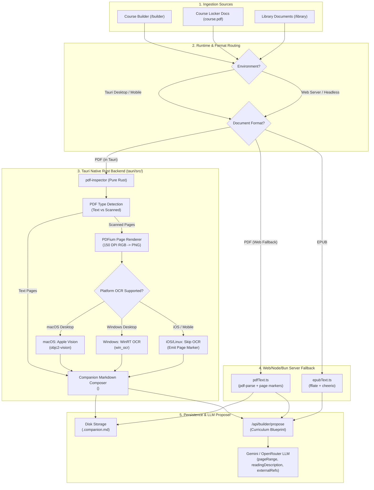

# PDF Text Extraction, Native OCR & Companion Markdown Architecture

## 1. Executive Summary

This document defines the production architecture for document ingestion, text extraction, native desktop OCR, and companion Markdown generation in the ILC Study Tool.

### Key Objectives
1. **Accompanying Companion Markdown**: Every PDF uploaded to the system—whether via Course Builder, Course Locker Docs (`assets/locker_docs/`), or the global Library (`data/library/`)—has an accompanying companion Markdown document (`<filename>.companion.md`) generated and tracked alongside the source binary.
2. **Deterministic Page-to-Content Mapping**: Extracted Markdown marks each physical page with `<!-- page: N -->` headers. Downstream LLM curriculum architect prompts use these markers to ground unit and lesson topics in precise textbook page ranges (`pageRange`), reading guides (`readingDescription`), and suggested external references (`externalRefs`).
3. **Cross-Platform Text Extraction (Desktop & Mobile)**: High-fidelity layout and Markdown extraction is powered by the Rust crate `pdf-inspector` directly embedded in the Tauri backend (`tauri/src/pdf.rs`). Because `pdf-inspector` (with default features disabled) is pure Rust based on `lopdf`, it compiles and runs cleanly across all target architectures, including desktop (macOS, Windows, Linux) and **mobile (iOS)**.
4. **Desktop-Only Native OS OCR**: OCR is strictly constrained to desktop environments, leveraging native OS APIs with zero third-party ML runtime overhead:
   - **macOS**: Apple `Vision.framework` via `objc2-vision` (Apple Neural Engine accelerated, zero Swift bridging).
   - **Windows**: Windows Media OCR via `win_ocr` (native WinRT).
   - **iOS / Mobile**: OCR is cleanly disabled (`is_ocr_supported() == false`). Scanned pages are gracefully deferred, avoiding multi-hundred-megabyte ML runtimes, ONNX models, or fragile Swift packages.
5. **EPUB Support**: Clean chapter extraction with the same `<!-- page: N -->` page/chapter mapping via `app/src/lib/server/epubText.ts`.

---

## 2. End-to-End System Architecture



---

## 3. Rust Backend Engine (`tauri/src/`)

### 3.1 Cargo Dependency Matrix

To ensure cross-platform compatibility without compilation breaks or huge binary bloat:

```toml
# General dependencies (compiles on macOS, Windows, Linux, and iOS)
[dependencies]
pdf-inspector = { version = "1.25.2", default-features = false }
image = { version = "0.25", default-features = false, features = ["png", "jpeg"] }

# Desktop macOS ONLY (excludes iOS)
[target.'cfg(all(target_os = "macos", not(target_os = "ios")))'.dependencies]
objc2 = "0.6"
objc2-foundation = "0.3"
objc2-vision = "0.3"

# Desktop Windows ONLY
[target.'cfg(target_os = "windows")'.dependencies]
win_ocr = "0.1"
```

> [!NOTE]
> `pdf-inspector` with `default-features = false` compiles completely in pure Rust via `lopdf`. It provides `extract_pages_markdown_mem` and `detect_pdf_type_mem` without pulling in heavy machine learning runtimes (e.g. `ort-sys`, ONNX, or PP-OCR).
>
> On macOS, `objc2-vision` calls Apple's native `VNRecognizeTextRequest` directly through the Objective-C runtime. This completely bypasses the Swift 6 / Xcode 16 compilation errors that break `apple-vision` (specifically `Float16` bridging failures).

### 3.2 Native OCR Module (`tauri/src/ocr.rs`)

The OCR module exposes a unified, thread-safe surface:

```rust
pub fn is_ocr_supported() -> bool;
pub fn run_native_ocr(png_bytes: &[u8]) -> Result<String, String>;
```

1. **`is_ocr_supported()`**:
   - Returns `true` on macOS desktop (`all(target_os = "macos", not(target_os = "ios"))`) and Windows (`target_os = "windows"`).
   - Returns `false` on iOS, Android, and Linux.
2. **`macos::recognize_text_from_image_bytes(bytes)`**:
   - Initializes `NSData` from PNG bytes.
   - Configures `VNRecognizeTextRequest` with `VNRecognizeTextRequestRevision3`.
   - Sets `VNRequestTextRecognitionLevel::Accurate`, `setUsesLanguageCorrection(true)`, and `setAutomaticallyDetectsLanguage(true)`.
   - Invokes `VNImageRequestHandler::initWithData_options(...)` and executes `performRequests_error`.
   - Iterates results and extracts candidate text strings ordered vertically.
3. **`windows::recognize_text_from_image_file(path)`**:
   - Uses Windows Runtime (`Windows.Media.Ocr.OcrEngine`) via `win_ocr` crate.

### 3.3 Companion Extraction & Page Rendering (`tauri/src/pdf.rs`)

The `PdfEngine` struct coordinates PDF rendering, per-page progress streaming, and companion Markdown generation:

```rust
#[derive(Debug, Clone, Serialize, Deserialize)]
pub struct CompanionResult {
    pub companion_path: Option<String>,
    pub markdown: String,
    pub page_count: u32,
    pub pdf_type: String,
    pub used_ocr: bool,
    pub pages_needing_ocr: Vec<u32>,
}

#[derive(Debug, Clone, Serialize, Deserialize)]
pub struct CompanionProgress {
    pub current_page: usize,
    pub total_pages: usize,
    pub stage: String, // "inspecting" | "extracting" | "ocr" | "done"
    pub is_ocr: bool,
    pub message: String,
}
```

#### Page Processing Flow in `extract_companion_markdown`:
1. **Initial Inspection**: Emits `inspecting` stage progress event to notifying UI that layout analysis has started.
2. **Classification & Extraction**: Calls `pdf_inspector::extract_pages_markdown_mem(pdf_bytes)`.
3. **Detection**: `pdf_inspector::detect_pdf_type_mem(pdf_bytes)` classifies the document (`Text`, `Linearized`, `Scanned`, `RasterImagesOnly`, `FormsOnly`, `EmptyOrCorrupt`).
4. **Selective OCR Routing with Real-time Progress Streaming**:
   - Inspects `pages_needing_ocr`.
   - Iterates page by page (`1..=total_pages`).
   - If `is_ocr_supported() == true` and OCR is required for the page:
     - Streams `stage: "ocr"`, `is_ocr: true`, `message: "Processing page N/total (OCR)..."`.
     - `PdfEngine::render_page_png_from_bytes(pdf_bytes, page_idx, 2.5)` renders the page at 150–200 DPI bitmap.
     - `run_native_ocr(&png_bytes)` transcribes the scanned bitmap into clean text lines.
   - If clean vector text:
     - Streams `stage: "extracting"`, `is_ocr: false`, `message: "Extracting page N/total..."`.
5. **Companion Assembly**:
   - Emits each page prefixed with `<!-- page: N -->` (1-indexed).
   - Joins pages with clean Markdown newlines.
   - Emits `stage: "done"` progress update.
   - If `pdf_path` is specified, writes the file to `<pdf_path>.companion.md`.

### 3.4 Tauri IPC Commands Registered (`tauri/src/lib.rs`)

```rust
#[tauri::command]
pub async fn pdf_generate_companion(
    app: AppHandle,
    state: State<'_, PdfEngineState>,
    path: String,
    force: Option<bool>,
    on_progress: tauri::ipc::Channel<CompanionProgress>,
) -> Result<CompanionResult, String>;

#[tauri::command]
pub async fn pdf_read_companion(
    app: AppHandle,
    path: String,
) -> Result<Option<String>, String>;

#[tauri::command]
pub async fn pdf_extract_companion_from_bytes(
    state: State<'_, PdfEngineState>,
    bytes: Vec<u8>,
    pdf_path: Option<String>,
    on_progress: tauri::ipc::Channel<CompanionProgress>,
) -> Result<CompanionResult, String>;
```

---

## 4. Frontend Client Integration (`app/src/`)

### 4.1 TypeScript IPC Client (`app/src/lib/tauri/pdfCompanion.ts`)

Encapsulates Tauri IPC calls with typed progress channel streaming:

```typescript
import { invoke, Channel } from '@tauri-apps/api/core';
import { isTauriEnvironment } from '$lib/pdfClient';

export interface CompanionProgress {
  current_page: number;
  total_pages: number;
  stage: 'inspecting' | 'extracting' | 'ocr' | 'done' | string;
  is_ocr: boolean;
  message: string;
}

export type ProgressCallback = (progress: CompanionProgress) => void;

export async function generateCompanion(
  path: string,
  force = false,
  onProgress?: ProgressCallback
): Promise<CompanionResult | null>;

export async function readCompanion(path: string): Promise<string | null>;

export async function extractCompanionFromBytes(
  bytes: Uint8Array | number[],
  pdfPath?: string,
  onProgress?: ProgressCallback
): Promise<CompanionResult | null>;
```

### 4.2 Course Builder Integration (`app/src/routes/builder/+page.svelte`)

When a user drops or selects a syllabus/textbook PDF in the Course Builder:
1. **Real-time Page & OCR Progress**:
   - Calls `extractCompanionFromBytes(bytes, undefined, (progress) => { ... })`.
   - The disabled action button immediately displays live progress:
     - OCR active: `[Spinner] Processing page 4/12 (OCR)...`
     - Vector text extraction: `[Spinner] Extracting page 5/12...`
     - Analysis complete: `[Spinner] Synthesizing curriculum blueprint with AI architect...`
   - An animated progress bar appears directly below the button showing exact percentage completion (`(current / total) * 100`) and an `"OCR Active"` badge whenever vision processing is underway.
2. **Proposer Submission**: The backend receives the pre-extracted, high-fidelity Markdown, skipping web server parsing entirely.
3. **Metadata Mapping**:
   - Lessons parse and display `pageRange` (e.g. `14-28`).
   - Lessons display `readingDescription` (e.g. `Sections 2.1-2.3: Read vector definitions and worked examples 1-4`).
   - Lessons display `externalRefs` as clickable pills (e.g. video and article links).

---

## 5. Server-Side Ingestion & Persistence (`app/src/lib/server/`)

### 5.1 EPUB Ingestion Engine (`app/src/lib/server/epubText.ts`)

- Extracts `.epub` archives using `fflate` (`unzipSync`).
- Parses `.xhtml` / `.html` chapters, stripping navigational boilerplate and scripts via `cheerio`.
- Annotates each chapter with `<!-- page: N -->` markers and heading anchors.

### 5.2 Universal PDF Fallback (`app/src/lib/server/pdfText.ts`)

- Standard fallback for web browsers and headless servers.
- Uses `pdf-parse` with embedded worker buffers.
- Normalizes extracted pages with `<!-- page: N -->` separators.

### 5.3 Storage Coordination

#### Course Locker Docs (`app/src/lib/server/courses.ts`):
- `saveLockerDoc(courseId, filename, buffer)`:
  - Writes `courseId/assets/locker_docs/<filename>`.
  - For PDF files, asynchronously generates `<filename>.companion.md` alongside the binary if not already present.
- `listLockerDocs(courseId)`:
  - Filters out `*.companion.md` and hidden files so companions remain sidecar metadata.
- `getLockerDocCompanion(courseId, filename)`:
  - Returns companion Markdown for API endpoints and LLM agents.
- `deleteLockerDoc(courseId, filename)`:
  - Automatically deletes `<filename>.companion.md` when the primary file is deleted.

#### Global Library Documents (`app/src/lib/server/library.ts`):
- `saveDocument(filename, buffer, meta)`:
  - Writes to `data/library/<filename>`.
  - For PDF files, generates `<filename>.companion.md`.
- `syncWithDisk()`:
  - Automatically detects unindexed PDFs placed in `data/library/` and triggers background companion generation.
- `getCompanionMarkdown(idOrFilename)`:
  - Retrieves companion Markdown.
- `deleteDocument(id)`:
  - Removes the file and companion Markdown.

### 5.4 REST API Endpoints (`app/src/lib/server/api.ts`)

| Endpoint | Method | Purpose |
|---|---|---|
| `/api/builder/propose` | `POST` | Accepts file (`.pdf`, `.epub`, `.html`, `.txt`) or `companionMarkdown` and generates structured curriculum blueprint. |
| `/api/courses/:id/locker-docs?companion=true&file=<name>` | `GET` | Fetches the companion Markdown for a course locker document. |
| `/api/library/companion/:id` | `GET` | Fetches the companion Markdown for a library document. |

---

## 6. Companion Markdown Format Specification

The `<filename>.companion.md` file adheres to this format:

```markdown
<!-- page: 1 -->

# Chapter 1: Kinematics

Kinematics is the branch of classical mechanics that describes the motion of points, bodies, and systems of bodies without considering the forces that caused the motion.

| Quantity | Symbol | SI Unit |
| :--- | :--- | :--- |
| Position | $\vec{d}$ | meters ($m$) |
| Velocity | $\vec{v}$ | meters per second ($m/s$) |
| Acceleration | $\vec{a}$ | meters per second squared ($m/s^2$) |

<!-- page: 2 -->

## 1.1 Uniform Acceleration Equations

When acceleration is constant, the following kinematic equations apply:
1. $v_2 = v_1 + a \Delta t$
2. $\Delta d = v_1 \Delta t + \frac{1}{2} a \Delta t^2$
```

### Prompt Correlation Rules:
- The presence of `<!-- page: N -->` enables LLMs to correlate specific curriculum topics to the exact physical page numbers of the course book.
- In `/api/builder/propose`, the LLM prompt instructs:
  > *"Analyze the provided document text, noting `<!-- page: N -->` demarcations. For each lesson or assignment, assign a realistic pageRange (e.g. '14-28') corresponding to the source document, and provide a readingDescription."*

---

## 7. Verification & Test Evidence

### 7.1 Rust Unit Tests (`tauri/`)
Executed via `cargo test --manifest-path tauri/Cargo.toml --lib -- --test-threads=1`:

```
running 3 tests
test courses_fs::tests::test_normalize_lesson_id ... ok
test pdf::tests::test_companion_extraction_from_sample_pdf ... ok
test pdf::tests::test_native_ocr_on_rendered_page ... ok

test result: ok. 3 passed; 0 failed; 0 ignored; 0 measured; 0 filtered out; finished in 3.15s
```

- **`test_companion_extraction_from_sample_pdf`**: Verifies `pdf-inspector` extracts tables, headings, and page boundaries into `<!-- page: 1 -->` format in 0.23 seconds.
- **`test_native_ocr_on_rendered_page`**: Renders a PDF page to a 150 DPI PNG bitmap using PDFium, feeds it to `run_native_ocr`, and verifies accurate text extraction via Apple Vision (`objc2-vision`).

### 7.2 Full Application Test Suite (`app/`)
Executed via `bun test`:

```
525 pass
0 fail
2287 expect() calls
Ran 525 tests across 50 files. [15.76s]
```

- **`Course Builder Endpoints`** (`app/src/lib/server/api.builder.test.ts`):
  - Verified `POST /api/courses` preserves `pageRange`, `readingDescription`, and `externalRefs`.
  - Verified `POST /api/builder/propose` ingests `companionMarkdown` directly.
  - Verified `POST /api/builder/propose` extracts `.epub` archives into `<!-- page: N -->` chapters.
  - Verified `GET /api/courses/:id/locker-docs?companion=true` retrieves locker doc companion files.
  - Verified `GET /api/library/companion/:id` retrieves library companion files.

---

## 8. Summary of Benefits

1. **Zero External Machine Learning Bloat**: No 500MB ONNX models, Python dependencies, or external OCR web services required.
2. **True Native Performance**: macOS uses Apple Neural Engine via `objc2-vision`; Windows uses WinRT.
3. **Mobile-Ready**: iOS builds compile cleanly using pure Rust `pdf-inspector`, with OCR conditionally excluded.
4. **Accurate Course Blueprints**: Every generated lesson maps directly back to the textbook pages students are reading.
