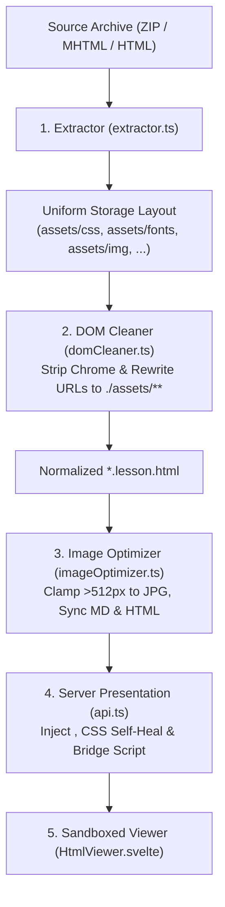

# ILC Course Import & HTML Normalization Specification

This document details the exact ingestion pipeline, heuristics, and normalization hacks used by CourseDeck to import and present courses originating from the TVO Independent Learning Centre (ILC) and D2L Brightspace. It delineates which rules are **ILC-specific hacks** and which strategies form the **generalizable architecture** for any HTML, MHTML, or SCORM package import.

---

## 1. Background & Course Package Origins

Courses from TVO ILC typically arrive in three formats:
1. **D2L Brightspace SCORM Export Zip Archives**: Compressed bundles containing a manifest, structured course units, lesson HTML files, and asset subtrees.
2. **Complete Webpage Saves (`*.html` + `*_files/`)**: Saved directly from a browser session with downloaded asset folders.
3. **MHTML Archives (`*.mhtml`)**: Single-file MIME HTML archives encapsulating the page DOM, inline stylesheets, and base64-encoded binary assets.

Because ILC content has evolved over more than a decade across multiple course authors and content management systems, there is significant structural heterogeneity across subjects and course codes (e.g. `mhf4u` Advanced Functions vs `mcr3u` Functions vs `baf3m` Financial Accounting).

---

## 2. Package Anatomy & Format Variants

CourseDeck encounters two primary ILC layout topologies:

### Variant A: Modern Brightspace Structure (e.g., `mhf4u`, `sph4u`)
```text
course_content/
├── lessons/                     # Or assignments/
│   ├── mhf4u_01.01.html         # Lesson HTML source
│   └── mhf4u_01.02.html
├── dependencies/                # Core framework files
│   ├── ilc_core.css             # Main styling, typography, callout boxes
│   ├── vendor.min.js            # Third-party scripts (MathJax, jQuery)
│   └── ...
└── assets/
    ├── img/                     # Lesson illustrations, diagrams, banners
    ├── icons/                   # UI icons and SVG glyphs
    └── locker_docs/             # Attached PDF worksheets, formulas
```
- **CSS Link Pattern**: `<link rel="stylesheet" href="../dependencies/ilc_core.css">`
- **Asset Image Pattern**: ``

### Variant B: InDesign / Legacy Layout Structure (e.g., `mcr3u`, older courses)
```text
course_content/
├── lessons/
│   ├── mcr3u_01.01.html
├── assets/
│   ├── css/
│   │   ├── ilc_core_temp.css    # Legacy stylesheet
│   │   └── idGeneratedStyles.css# Adobe InDesign HTML export styles
│   ├── img/
│   └── locker_docs/
```
- **CSS Link Pattern**: `<link rel="stylesheet" href="../assets/css/ilc_core_temp.css">` and `<link rel="stylesheet" href="idGeneratedStyles.css">`
- **Asset Image Pattern**: Mixed relative paths (`img/...`, `../assets/img/...`, `../images/...`).

---

## 3. The Normalization Pipeline

To eliminate format differences and enable flawless presentation in the sandboxed HTML lesson viewer, CourseDeck processes archives through a uniform five-stage normalization pipeline:



### Stage 1: Extraction & File Classification (`extractor.ts`)
During zip, MHTML, or HTML extraction, all files are categorized into canonical subdirectories regardless of where they appeared in the source package:
- **`assets/css/`**: All `.css` stylesheets (`ilc_core.css`, `ilc_core_temp.css`, `idGeneratedStyles.css`, etc.).
- **`assets/fonts/`**: Web font files (`.woff`, `.woff2`, `.ttf`, `.otf`, `.eot`).
- **`assets/img/`**: Raster images (`.png`, `.jpg`, `.jpeg`, `.gif`, `.webp`).
- **`assets/icons/`**: Vector icons (`.svg`).
- **`assets/locker_docs/`**: Attached documents (`.pdf`, `.docx`, `.xlsx`, audio/video).

### Stage 2: DOM Cleaning & Path Rewriting (`domCleaner.ts`)
The `preparePresentationHtml()` function runs Cheerio against each extracted HTML file:
1. **Chrome & Script Stripping**:
   - Removes Brightspace navigational headers, footers, breadcrumbs, search bars, and pagination controls (`.d2l-navigation`, `header`, `footer`, `nav`, `.d2l-page-header`).
   - Removes third-party tracking scripts, obsolete jQuery embeds, and unneeded interactive applets.
2. **Stylesheet Link Rewriting**:
   - Replaces any `<link rel="stylesheet" href="...">` with a standardized path:
     ```html
     <link rel="stylesheet" href="./assets/css/<filename>">
     ```
   - Retains font definitions and print stylesheets while standardizing relative links.
3. **Asset URL Normalization**:
   - All `` tags: rewritten to `./assets/img/<filename>` (or `./assets/icons/<filename>` for SVGs).
   - All document links (`<a>`, `<video>`, `<audio>`, `<source>`): rewritten to `./assets/locker_docs/<filename>`.
   - Inline `style` attributes containing `url(...)`: rewritten to point to `./assets/img/<filename>` or `./assets/icons/<filename>`.

### Stage 3: Image Optimization & Reference Alignment (`imageOptimizer.ts`)
To maintain fast load times and small archive footprints:
1. **Pass 1 (Compression)**: Raster images wider than 512px are resized to 512px progressive JPEG (quality 82) via `Bun.Image`.
2. **Pass 2 (Markdown Sync)**: Markdown files (`*.md`) are updated to point to the new `.jpg` filenames.
3. **Pass 2b (HTML Sync)**: All `.lesson.html` files are updated to replace original `.png` references with the optimized `.jpg` filenames.
4. **Pass 3 (Safe Cleanup)**: Original oversized images are deleted only after both Markdown and HTML files have been successfully rewritten.

### Stage 4: Asset Serving & Fallback Engine (`courses.ts` & `api.ts`)
When assets are requested via `GET /api/courses/:course_id/assets/**`:
1. **6-Step Asset Resolver (`CourseService.resolveAssetPath`)**:
   - **Step 1**: Direct relative path under `assets/`.
   - **Step 2**: Direct path under course root.
   - **Step 3**: Categorized subfolder lookup (`assets/{css,img,icons,locker_docs,fonts,dependencies}/<filename>`).
   - **Step 4**: Flat lookup directly in `assets/<filename>`.
   - **Step 5 (Fuzzy Raster Extension Match)**: If `file.png` was requested but `file.jpg` (or `.webp`) exists due to image optimization, the existing file is returned automatically.
   - **Step 6 (Self-Healing from Archive)**: If missing on disk, inspects `_backup/*.zip` and eagerly extracts missing assets (including `.html`, `.pdf`, `.docx` in `locker_docs/`) into `assets/locker_docs/`.
2. **1x1 Transparent Fallback for Broken Images**:
   - If an image file does not exist anywhere on disk (e.g. omitted by the course provider in the original SCORM package, such as `mhf4u_u1.3_graph3.png`), the backend returns HTTP 200 with a 68-byte transparent 1x1 PNG (`X-Asset-Fallback: transparent-pixel`).
   - **Benefit**: Eliminates unsightly broken image placeholders, layout collapse, and console 404 noise.

### Stage 5: Sandboxed HTML Presentation & Interactive Bridge (`api.ts` & `HtmlViewer.svelte`)
When serving `GET /api/courses/:course_id/:lesson_id/content`:
1. **Base URL Injection**: Injects `<base href="/api/courses/${courseId}/">` into the `<head>` so all normalized `./assets/...` links resolve cleanly against the backend API.
2. **Self-Healing CSS Injection**: Discovers any stylesheets in `assets/css/` (or extracts them from `_backup/` if missing) and injects `<link rel="stylesheet" href="./assets/css/<file>">` if the HTML lacked stylesheet references.
3. **Interactive Bridge Script & Seamless Height Architecture**:
   Injects an event interception and height-management script in `<head>`:
   - **Seamless Full-Height Iframe (No Nested Wiggle-Room)**:
     Injects `html, body { overflow-x: hidden !important; overflow-y: hidden !important; }` and registers `<iframe scrolling="no">` in `HtmlViewer.svelte`. The bridge calculates the true content height (`Math.max(body.scrollHeight, html.scrollHeight, body.offsetHeight, html.offsetHeight)`) and posts `courseDeck:lessonHeight` on `load`, `DOMContentLoaded`, dynamic timeouts, and via `ResizeObserver` on both `body` and `documentElement`. The iframe expands to span the **full height** of the lesson, completely removing nested scrollbars, micro-scrolling, and vertical "wiggle room".
   - **Template Literal Escaping Safety**:
     All string matching within the injected bridge script uses pure string methods (`endsWith('.html')`, `startsWith('https://')`, `includes('locker_docs/')`) rather than regex literals inside template strings, eliminating syntax errors from unescaped quantifiers.
   - **Bootstrap Accordions & Hash Anchors (`data-toggle="collapse"`, `href="#..."`)**:
     Intercepts clicks, calls `e.preventDefault()`, and programmatically toggles the collapse panel (`.collapse` / `.collapse.in`, `display: block/none`, `aria-expanded`, `.collapsed` class), closing sibling panels if `data-parent` is present. Crucially, **prevents the browser from resolving `#href` against `<base href>` into a blank page**, and triggers `sendHeight()` to resize the iframe dynamically.
   - **Internal Lesson & Assignment Links (`../assignments/*.html`, `../lessons/*.html`)**:
     Intercepts lesson links, strips course prefixes (e.g. `mhf4u_u4la9_assign_1` -> `04-09_assign1`, `mhf4u_01.02` -> `01-02`), and posts `courseDeck:navigateLesson` to the parent window, smoothly transitioning CourseDeck's active lesson and sidebar.
   - **Locker Docs Links (`../assets/locker_docs/*`)**:
     Intercepts document references, normalizes the URL to `/api/courses/:course_id/assets/locker_docs/:filename`, and posts `courseDeck:openDocument` to open the full-page `DocumentViewerModal`.
   - **External Web Links (`https://...`, `http://...`)**:
     Intercepts external links (e.g. `https://davidsuzuki.org`) and posts `courseDeck:openDocument` to open `DocumentViewerModal`. Because external domains block framing via CSP and `X-Frame-Options`, `DocumentViewerModal` presents a dedicated external website preview card displaying the destination URL, description, and an "Open in Browser" action that calls Tauri's native opener or system browser. (Also generalized in `MarkdownViewer.svelte` for all course pages).
4. **Header Framing**: Disables `X-Frame-Options` on this endpoint to permit sandboxed iframe rendering within the CourseDeck window.

---

## 4. Separation: ILC-Specific Hacks vs Generalizable Architecture

To keep the codebase maintainable, we strictly distinguish between one-off ILC quirks and universal HTML import capabilities:

| Feature / Technique | Classification | Scope & Implementation |
| :--- | :--- | :--- |
| **D2L Navigation Selectors** (`.d2l-navigation`, `ilcLearningGoals`, `mindsOn`) | **ILC-Specific Hack** | Isolated strictly to `domCleaner.ts` cleanup rules. |
| **Specific CSS Names** (`ilc_core.css`, `ilc_core_temp.css`, `idGeneratedStyles.css`) | **ILC-Specific Hack** | Documented fallback list in `api.ts` self-healing CSS logic. |
| **Categorized Asset Extraction** (`assets/{css,img,icons,fonts,locker_docs}`) | **Generalizable Architecture** | Universal extraction layout for all ZIP, MHTML, and EPUB importers. |
| **`<base href="...">` Sandbox Addressing** | **Generalizable Architecture** | Allows relative paths in imported HTML to resolve cleanly without absolute path mangling. |
| **Accordion Hash Click Interception** | **Generalizable Architecture** | Prevents `<base href>` hash-navigation blank pages and provides lightweight native accordion toggling. |
| **Internal Cross-Lesson Bridge Routing** | **Generalizable Architecture** | Translates internal HTML document links into app-level lesson transitions via `postMessage`. |
| **External & Document Modal Viewer** | **Generalizable Architecture** | Opens external websites and attached locker docs in `DocumentViewerModal` across both Markdown and HTML lessons. |
| **Fuzzy Raster Extension Matcher** (`.png` ↔ `.jpg` ↔ `.webp`) | **Generalizable Architecture** | Resilient asset resolution that tolerates backend image optimization/transcoding. |
| **1x1 Transparent Pixel Fallback** | **Generalizable Architecture** | Prevents broken layouts on 404 image requests for any imported web document. |
| **ResizeObserver Iframe Height Bridge** | **Generalizable Architecture** | Clean, seamless iframe embedding without nested scrollbars. |

---

## 5. Verification & Testing

The normalization pipeline is guarded by automated test suites in `app/src/lib/server/`:
- `api.builder.test.ts`: Verifies HTML content endpoint base href injection, discovered stylesheet injection, height bridge scripts, fuzzy image resolution, and transparent pixel fallbacks.
- `courses.tabs.test.ts`: Verifies multi-format lesson discovery (`.lesson.html`, `.lesson.pdf`, `.lesson.md`), companion document routing, and categorized asset resolution.
- `bun test src/lib/server/api.builder.test.ts src/lib/server/courses.tabs.test.ts`
