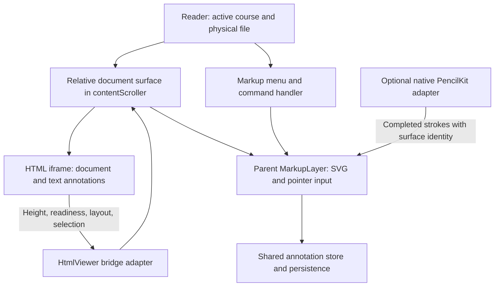

# Markup over HTML, Markdown, and PDF

Status: architecture review and implementation plan, 2026-11-11. This document
records code inspection and proposed changes; it does not mean the HTML markup
fix or the verification below has been implemented. Companion reference:
[annotations.md](annotations.md), which covers selected-text highlights, notes,
and Ask AI checkpoints.

## Decision

Render HTML freehand markup with the shared `MarkupLayer.svelte` in the parent
document, directly above the iframe. Keep pointer sampling, stroke rendering,
eraser operations, history, and persistence in the parent. Keep the iframe
bridge for document geometry, navigation, text selection, and text highlights.

This is the right architecture for the existing full-height iframe reader. The
immediate defect is missing integration, not evidence that drawing needs to move
into the iframe. However, adding the component alone is insufficient for reliable
loading, file isolation, touch input, and native drawing.

Two different features must remain distinct:

- **Freehand markup:** pen, freehand highlighter, and eraser operate on stroke
  coordinates in `.annotations.json`. This is the subject of this document.
- **Text annotations:** the floating trigger highlights a selected range or
  attaches a note/AI question to a source anchor. HTML range resolution and
  highlight painting belong inside the iframe. Keep that existing bridge path.

All annotations belong to the actual file being displayed. Original HTML and
companion Markdown have separate strokes and histories. No migration, aliases,
old-key lookup, or mapping between those representations is required. PDF keeps
its existing page-specific coordinate system.

## Evaluation of the supplied proposal

| Claim | Assessment and improved decision |
| --- | --- |
| A parent overlay is recommended | Agree. It reuses the application's renderer and store without depending on parent access to the iframe DOM. |
| Direct drawing has zero latency and guarantees 60–120 FPS | Overstated. It removes messaging from the pointer path; event handling, outline computation, layout, and painting still cost time. Measure performance on representative hardware. |
| `postMessage` necessarily causes high latency/stutter | Overstated. Messages are asynchronous and use structured serialization, but performance depends on workload. An iframe renderer could draw locally and send completed strokes, without sending every pointer point. That is a viable alternative with more integration work here. |
| Drawing inside the iframe necessarily duplicates all math | Not inherently: pure rendering modules can be shared. Nevertheless, mounting the existing parent component is simpler than introducing an iframe application/runtime and a second input owner. |
| PencilKit works out of the box at the top-level webview | Incorrect as a general claim. PencilKit is a native view integrated through a plugin. CourseDeck has that integration, but file ownership, bounds, coordinate conversion, activation, and handoff still need verification. |
| PencilKit is incompatible with iframe content | Too strong. Native drawing can overlay a webview containing an iframe. Coordinate mapping and input ownership are the challenges; the iframe is not categorically incompatible. |
| Parent scrolling guarantees perfect alignment | Correct only while content layout stays unchanged and the iframe truly has no independent scrolling. Late images, accordions, fonts, and responsive reflow can move content beneath stored strokes. |
| Inactive `pointer-events: none` passes interaction through | Correct for the web overlay, provided descendants do not re-enable interception. Native drawing must also deactivate; its hit testing is separate from CSS. |
| ResizeObserver solves dynamic document layout | It updates canvas bounds. It does not reposition stored strokes to follow moved text or images. Same-height layout changes can also evade a container-size observer. |
| `!isLoading` means the iframe has reported its first height | Incorrect in the current code: an `onload` timer also clears `isLoading` after 350 ms. Introduce a separate geometry-ready condition. |

The messaging assessment follows the [HTML messaging specification](https://html.spec.whatwg.org/multipage/web-messaging.html#posting-messages).
Apple describes explicit integration of `PKCanvasView` into the application's
view hierarchy in its [PencilKit documentation](https://developer.apple.com/documentation/pencilkit).
The performance and architecture conclusions above are engineering judgments,
not measured frame-rate results.

## What the current repository actually does

| Location | Finding | Consequence |
| --- | --- | --- |
| `app/src/lib/components/HtmlViewer.svelte` | No `MarkupLayer` import, markup props, or overlay mount. | HTML currently has no freehand drawing surface. |
| `app/src/lib/components/MarkdownViewer.svelte` | Mounts `MarkupLayer` over the rendered document and passes the reader scroller. | Reuse this implementation and preserve Markdown behavior. |
| Course reader `+page.svelte` | `MarkupMenu`, Markdown `markupFile`, and markup undo/redo use `currentFile`; `annotationFile` already distinguishes physical sources. | Changing only the HTML viewer would leave commands and companion Markdown inconsistently scoped. |
| `HtmlViewer.svelte` | Full-height iframe, `scrolling="no"`, source/session checks, height messages, and a loading fallback timer. Outer card has a border and clipping; iframe height is animated. | Use a separate undecorated surface with matching iframe/overlay bounds and an explicit readiness contract. |
| `app/src/lib/server/lessonBridge.ts` | Reports height using the maximum body/root dimensions, including viewport size; observes layout changes. | Existing reporting is useful, but viewport-dependent height can prevent shrinking. Verify inner scroll and accordion behavior. |
| `MarkupLayer.svelte` | Absolute SVG overlay, z-index 10, inactive pointer pass-through, ResizeObserver, author-width scaling, shared native listeners. | Most drawing machinery is reusable; geometry, lifecycle, and native ownership need hardening. |
| `app/src/lib/markup/types.ts` | Stores points plus `authorWidth`; no source-block attachment. Both axes scale by current/author width. | Stroke shape scales uniformly, but it does not follow responsive text reflow. Correct the comment that suggests otherwise. |
| `app/src/lib/markup/annotationStore.svelte.ts` | Per-course cache, file-specific histories, debounced upserts. Failed saves requeue in memory; failed HTTP loads can still mark a course loaded. | Do not equate visible ink with durable storage. Add explicit failure and retry tests. |
| `app/src/lib/markup/pencilKit.ts` / `tauri/Cargo.toml` | Native plugin adapter and external iOS plugin dependency exist. | Native capability is conditional; the DOM overlay itself does not provide PencilKit. |
| `scripts/checkpoint-trigger-browser.mjs` | Existing coverage is for checkpoints; the reader fixture does not provide a markup file to activate freehand markup. | Previous HTML checkpoint test success did not verify HTML freehand drawing. |

These findings come from repository code. No actual course content or native
plugin implementation was inspected for this review, and no device test was run.

## Architecture and invariants



1. One active drawing surface owns input at a time. A document modal, PDF reader,
   or another viewer cannot leave a hidden HTML surface accepting native events.
2. The actual document key drives rendering, clear, undo, redo, native ownership,
   and persistence. Use `annotationFile` for both HTML and Markdown viewers and
   the associated menu/commands. Keep PDF's own page keys.
3. The HTML surface contains only the block-level, borderless iframe and overlay.
   Put card borders, padding, loading UI, and checkpoint gutters outside it.
4. `contentScroller` owns ordinary vertical scrolling. Do not add its scrollTop
   a second time to points derived from viewport-relative rectangles.
5. Loading, invalid dimensions, inactive reader, editing, or a modal suspend
   drawing. Reading-mode ink remains visible when enabled but intercepts no input.
6. The bridge remains a small document adapter. No pointer-by-pointer stroke
   forwarding, freehand outline implementation, or duplicate annotation store.

### Coordinate contract

Use CSS pixels throughout the web drawing path, not device pixels. With no CSS
transform on the surface:

```text
surfaceX = event.clientX - surfaceRect.left
surfaceY = event.clientY - surfaceRect.top
authorX  = surfaceX / scale
authorY  = surfaceY / scale
scale    = currentSurfaceWidth / authorWidth
```

At stroke start, capture the course/file/surface identity and author width. Store
points against that identity through completion, even if reactive route values
change. Use the same transform for rendering and eraser hit testing. Re-read
geometry when scrolling changes the viewport rectangle; cancel an in-progress
stroke if a width/layout change invalidates its coordinate frame. Do not introduce
arbitrary header offsets into stored coordinates.

The iframe viewport origin and the undecorated surface origin must coincide.
The iframe body's own margin is already part of its document coordinates; do not
subtract it again. Avoid CSS scaling of the document wrapper; if required later,
use a tested inverse transform rather than assuming width scaling handles every
transform. Native viewport coordinates must be verified against CSS pixels,
safe areas, webview offsets, and visual viewport zoom.

### Layout changes are a separate problem

Scrolling an unchanged document moves content and overlay together. Increasing
canvas height merely makes more area drawable. Neither operation anchors a
stroke to a paragraph.

For example, drawing at y=1200 and then expanding a 300px accordion above that
point leaves today's stroke at y=1200 while its intended content moves to y=1500.
Likewise, a 700px-wide paragraph becoming 350px wide does not make every vertical
coordinate exactly half as large: text wraps into more lines.

The initial HTML fix should match the existing Markdown freehand behavior and
state this limitation. It must not claim durable passage alignment after reflow.
For precise text emphasis, retain the source-anchored text-highlight feature.

For a subsequent reflow-aware freehand method, reuse **same-file** source IDs:

- Add an explicit attachment kind for new strokes: document, source block, or
  fixed visual object such as an image. Keep original stroke geometry immutable.
- Record the selected owner's stable ID and author-space origin/bounds. Resolve
  its current rectangle on layout revisions. Translate block-local strokes with
  the block; scale image-local strokes with the image while preserving aspect
  ratio. A block rectangle alone cannot follow individual wrapped text lines.
- Use one owner per freehand stroke/group initially. Strokes spanning unrelated
  blocks remain document-local; do not silently split handwriting or infer text
  intent. Text-range highlighting is the appropriate method for line reflow.
- Persist required source IDs using the existing source-anchor operation before
  considering an attached stroke durable. Absolute document strokes need no
  source modification. Missing/deleted owners produce an unresolved state, never
  reassignment to another file or a guessed nearby paragraph.
- HTML needs batched owner-geometry queries through the bridge; Markdown can
  resolve locally through the same small geometry interface. Query at stroke
  attachment/layout boundaries, never for each pointer sample. Include request,
  document session, and layout revision so late responses cannot attach wrongly.
- Adopt only the new attachment schema when implemented; no conversion or lookup
  compatibility layer for earlier records is requested.

This follow-up is independent of the missing-overlay repair and should have its
own acceptance tests before being called reflow-safe.

## Implementation plan

### 1. Integrate the shared surface and correct file ownership

- Add `markupFile?: string` to `HtmlViewer`. Reuse its existing `scrollerEl` for
  `MarkupLayer.scrollerEl`; a second `markupScroller` prop with the same meaning
  adds unnecessary opportunities for disagreement.
- Bind a reactive `surfaceEl` to an inner `position: relative` wrapper containing
  the iframe and `MarkupLayer`. Keep the current decorated card outside it.
- Pass `markupFile={annotationFile}` to HTML **and Markdown**, and use that same
  identity in `MarkupMenu`, hotkeys, clear, and native commands.
- Key the surface lifecycle by course + physical file + iframe document URL.
  Remount on source change, not on every height update. Flush completed strokes
  and cancel unfinished input before releasing an old surface.
- Make menu availability depend on an actual ready drawable surface, rather than
  only excluding a couple of tab names. Cover generated Markdown tabs and course
  documents; leave schedule/test/custom viewers without a markup surface disabled.
- Keep Markdown-only “extend page” from modifying companion Markdown while the
  user is viewing original HTML. Disable that action for HTML until there is an
  explicit HTML extension design.

Suggested structure (illustrative; readiness is added in the next step):

```svelte
<div class="html-card">
  {#key surfaceIdentity}
    <div bind:this={surfaceEl} class="relative">
      <iframe ... />
      {#if markupFile && geometryReady}
        <MarkupLayer
          {courseId}
          file={markupFile}
          containerEl={surfaceEl}
          {scrollerEl}
        />
      {/if}
    </div>
  {/key}
  <!-- Loading/error UI belongs outside the measured document surface. -->
</div>
```

### 2. Make readiness and height updates reliable

- Separate the loading indicator from `geometryReady`. Reset readiness when the
  document changes. A 350ms timer must not authorize drawing.
- Require a valid height message from the current iframe/session, finite positive
  dimensions, applied iframe height, and a matching measured surface after Svelte
  layout. Reject NaN/Infinity and malformed geometry. If the bridge is missing,
  leave drawing disabled and expose a retry/error state rather than guessing.
- Remove the iframe height transition so drawing bounds do not lag the reported
  layout. Reuse a ResizeObserver that follows the actual bound element; disconnect
  it and cancel pending animation frames on identity changes/unmount.
- Measure document content independently of the absolute overlay. In the shared
  component, avoid using overflow caused by an old tall SVG to determine the new
  document height; otherwise shrinking can feed back on itself.
- Verify intrinsic iframe height both grows and shrinks. The present maximum
  includes the iframe viewport, which can retain a previous large height. Add a
  tested intrinsic-content measurement in the bridge if necessary, without a
  temporary visible shrink, repeated padding additions, or a resize loop.
- Validate parent-scroll ownership for wheel, touch, keyboard navigation, fragment
  links, and accordion changes. `scrolling="no"` alone does not prove scrollY is
  always zero. Report/detect unexpected inner scrolling; do not silently draw
  against a moving inner viewport. Nested scrollable content needs separate
  attachment support or an explicit restriction while drawing.
- If later attachment support needs it, publish a debounced layout revision even
  when overall height is unchanged. Filter overlay-generated mutations to avoid
  self-triggered refresh loops.

### 3. Harden shared input, focus, and layering

- Keep the existing pen/highlighter/eraser pipeline. Batch coalesced samples and
  update the live SVG outline at most once per animation frame; currently every
  appended coalesced point recalculates the path. Preserve the final sample on up.
- Define one termination path for up, cancel, lost capture, mode exit, navigation,
  and unmount. Commit a valid completed stroke exactly once; discard interrupted
  previews on cancellation. Current `pointercancel` commits partial strokes, so
  changing that behavior needs tests shared with Markdown.
- Test pointer capture for mouse, pen, and touch on each engine; do not rely on
  the current “mouse only; WebKit routes pen/touch” assumption. Clear tracked
  touches and stop inertia when input ownership ends. Accept primary drawing
  buttons, preserving context-menu behavior.
- Preserve deliberate gesture modes: normal mode draws with one finger and pans
  with two; pencil-only mode pans with fingers and draws with the stylus. Palm
  input must not terminate or duplicate pen strokes. Declare `touch-action` before
  the gesture begins and restore ordinary browser interaction when inactive.
- Focus the parent drawing surface when markup is activated so keyboard commands
  do not stay trapped in iframe focus. Use one command handler for Cmd-Z,
  Cmd-Shift-Z, Ctrl-Z, Ctrl-Shift-Z, and Ctrl-Y. Never take undo from inputs,
  contenteditable, note/AI composers, or an unrelated active viewer. If iframe
  focus must be supported, forward only enabled markup commands with existing
  source/session checks; iframe keyboard events do not bubble to the parent.
- Keep ink inside page bounds and checkpoint markers outside them. Controls and
  popovers must sit above drawing layers. Suppress floating-trigger activation
  during an active stroke and suspend drawing while a note/AI modal is open;
  preserve access to saved markers and menu controls without accidental ink.
- Check highlighter compositing above iframe content in light/dark themes; a
  separate composited iframe can differ from the Markdown backdrop.

Pointer capture, cancellation, and gesture handling should follow the
[Pointer Events specification](https://www.w3.org/TR/pointerevents3/), with
feature detection for optional sample APIs and real device verification.

### 4. Make native PencilKit an explicit optional input owner

- Require actual plugin readiness; platform/user-agent guesses alone must not
  suppress working web pen input. If activation fails, retain the Pointer Events
  implementation and expose an appropriate status.
- Activate with course/file/surface identity and visible target bounds. The current
  generic `MarkupLayer` activation supplies only active state/top cutoff, and its
  callback assigns incoming native strokes to the current reactive `file`.
- Extend/verify the plugin event contract to carry an immutable drawing-session
  identity. Late strokes must persist to their originating file or be explicitly
  rejected, never assigned to the newly opened lesson. Do not treat an unscoped
  native event as compatible with the new method.
- Account for scroll movement between native stroke capture and callback delivery.
  Converting historical viewport points using only the callback-time DOM rectangle
  is insufficient if the document moved. Use capture-time geometry or a native
  document-coordinate contract, and verify the installed plugin supports it.
- Only one registered surface consumes native strokes/undo/redo. Deactivate and
  hand off ownership when a PDF/modal replaces HTML; include gutter controls and
  menus in native excluded regions. CSS z-index cannot control a native overlay.
- Acknowledge native stroke handoff after the corresponding SVG update has been
  applied, with bounded recovery for failures. The existing fixed two-second timer
  is not proof of painting. Render acknowledgement and durable-save acknowledgement
  are separate concepts; do not discard the only recoverable copy of unsaved ink.
- Verify this path on actual iPad hardware. Desktop and Android continue using the
  shared web renderer without an Apple dependency.

### 5. Verify persistence and fix demonstrated store failures

- Reuse the course annotations API and store. HTML needs a different `file` value,
  not a second storage format or copied persistence pipeline. Check that validators,
  server merges, native storage, and pending sync preserve `.lesson.html` keys.
- Surface pending/saved/error state. Only mark initial load successful after a
  successful response; permit retry after non-OK responses.
- Serialize flushes per course or reconcile their revisions. A failed old request
  currently requeues its snapshots unconditionally and can overwrite a newer
  queued erase/undo for the same stroke. Preserve the latest operation on retry.
- Persist completed changes promptly to durable local storage on supported offline
  paths. A debounced in-memory queue plus `beforeunload` is not a crash-safe outbox.
  Handle visibility changes on `document`; the current listener is on window.
- Trigger ordinary navigation flushes without changing captured file identities.
  Verify rapid lesson switches, reload, failure/retry, tombstones, and sync conflict
  ordering. Keep a failed local save recoverable and visibly unsaved.
- Do not imply that offline annotation storage makes HTML documents available
  offline: `HtmlViewer` still obtains its content from the existing API URL.

## Delivery sequence and scope

1. **HTML repair:** shared overlay, physical file identity everywhere, geometry
   readiness, stable bounds, safe input lifecycle/focus, persistence regression
   coverage. This restores the currently missing HTML drawing capability.
2. **Cross-platform completion:** validate/harden native ownership and store retry
   behavior, then execute the platform matrix. These are required before claiming
   reliable mobile/native support, even if the desktop fix ships first.
3. **Reflow-aware freehand improvement:** introduce explicit same-file attachments
   with separate tests. Keep the initial repair's author-pixel limitation explicit.

Prefer small shared helpers for geometry, gesture completion, and command routing.
Do not create a general reader framework or duplicate `MarkupLayer` in the bridge.
Update Markdown-specific comments and remove redundant scroller props as touched.
Preserve PDF's independent page-local behavior and the checkpoint source-anchor
workflow. No migration work is included.

## Verification and acceptance

Use synthetic HTML/Markdown fixtures for automated tests, including a real iframe
and real `MarkupLayer`/store. The existing checkpoint fixture is insufficient.
For any real course inspection, use the `coursedeck` MCP tools per `AGENTS.md`.

| Area | Required cases and observable result |
| --- | --- |
| Basic HTML drawing | Pen, freehand highlighter, eraser at top/middle/bottom of a long lesson; paths visible and eraser targets the displayed stroke. |
| Geometry | At fixed layout, pointer-to-ink alignment within 2 CSS px excluding stroke thickness; scroll down/up and return to the same document position without drift. No 50/100px correction constants. |
| Frame lifecycle | Delayed/missing height, late image/font, accordion grow/shrink, rapid navigation, stale session messages, empty/invalid dimensions; no phantom surface, accumulating height, or cross-file stroke. |
| Bounds/reflow | Resize and orientation update coverage without loops or clipped active input. Check same-height reflow too. Record author-pixel drift as an initial limitation; attachment-following tests become mandatory for phase 3. |
| Identity | Draw separately on original HTML, companion Markdown, normal Markdown, summary, and a course document; reload each. Undo/redo/clear affects only that course and physical file. No migration lookup. |
| Reading interaction | Exit/hide markup; iframe links, forms, text selection, scrolling, selected-text highlights, checkpoint markers, and AI/note composers remain usable. |
| Input boundaries | Start/leave/release outside surface, cancellation, lost capture, right click, mode exit, navigation mid-stroke; no stuck drawing or duplicate/partial cancellation commits. |
| Keyboard | Both Mac and Windows/Linux shortcut conventions, iframe focus, and editable fields; document edits keep their own undo. |
| Touch/pen | One-finger drawing, two-finger pan, pencil-only finger pan, palm contact, stylus pressure fallback, orientation, background/resume. No phantom strokes from panning. |
| Native handoff | Real iPad: delayed/batched strokes across scroll/navigation, exact origin identity, bounds/safe areas, PDF/modal ownership, no duplicate ink, plugin-unavailable fallback. |
| Persistence | Reload after confirmed local save, failed initial GET, failed PUT then erase/undo, overlapping flushes, offline queue and reconnect; no resurrection or false saved state. |
| Performance | Profile long HTML documents and hundreds of strokes, fast input and coalesced events; report frame times/input delay and hardware. No unmeasured FPS guarantee. |

Run focused shared geometry/store tests, markup rendering tests, iframe browser
regressions, and app/server type checks after implementation. Validate on Chromium,
Firefox, and WebKit where available, then native Windows WebView2, macOS WKWebView,
Linux WebKitGTK, iPadOS with Pencil, iOS browser touch, and Android WebView/browser.
Emulated touch tests do not substitute for real stylus, native plugin, or webview
testing. Record which environments actually passed and leave the rest unverified.

This review only adds the plan. HTML freehand functionality and the acceptance
matrix remain pending implementation and execution.
